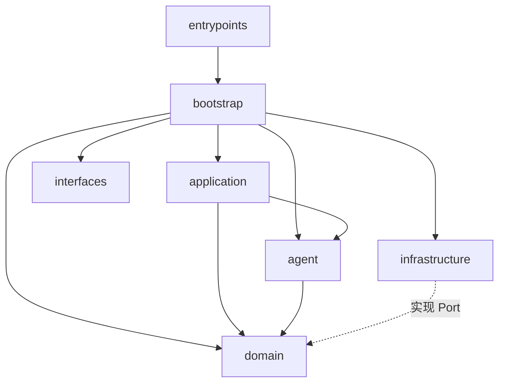

# BoxAgent 代码架构导览

这份文档给你一张能按图索骥的代码地图，并在末尾给出按优先级排序的代码质量改进清单。

本文所有行号取自当前工作区（2026-11-18，`git log` 74 次提交，工作区有未提交改动）。

---

## 0. 怎么读

1. 只想知道结论：读 §1、§5、§7.1。
2. 准备动手改代码：先读 §3 四条主链路，再读 §6 清单。
3. 只有 30 分钟：读 §1 代码地图 + §2 运行时全景 + §7.1 第 1-4 步。

---

## 1. 代码地图

### 1.1 规模

| 范围 | 文件数 | 行数 | 备注 |
| --- | --- | --- | --- |
| Python 包 `boxagent/` | 265 | 41,338 | 含 vendored 记忆引擎 |
| 其中自研部分 | 222 | 24,803 | 去掉 `infrastructure/memory/jev_mem/` |
| 其中 vendored `jev_mem/` | 43 | 16,535 | MIT，上游 commit `7ab0c73` |
| 前端 `web/` | — | 约 13,200 | TS/TSX/CJS，不含 `node_modules`、`dist` |
| 测试 `tests/` | 52 | 14,053 | `git log` 74→77 次提交后新增伴生与微信用例 |

一句话：这是一个“Python 后端 + Electron/React 前端 + 若干外部模型子进程”的本机应用，自研代码约 2.5 万行，规模适中但单文件密度不均。

### 1.2 分层与职责

| 层 | 自研行数 / 文件 | 职责 | 该层最该看的文件 |
| --- | --- | --- | --- |
| `entrypoints/` | 380 / 8 | 进程入口，只解析参数并调用 Bootstrap | `engine.py`（48 行）、`desktop_service.py`（59 行） |
| `bootstrap/` | 1,919 / 16 | 生产装配点：唯一允许 `new` 具体实现的地方 | `engine.py:228 create_application`（476 行文件） |
| `application/` | 4,488 / 26 | 跨领域用例编排、应用级 Facade | `assistant.py`（880 行）、`turn_preparation.py`（174 行） |
| `domain/` | 4,078 / 53 | 业务规则与状态转换，不碰模型/UI/存储 | `interaction/service.py`（946 行）、`execution/service.py`、`notification/service.py` |
| `agent/` | 1,316 / 19 | Harness（上下文编译）+ Runtime 契约 | `harness/request_builder.py`、`harness/executor.py`、`runtime/registry.py` |
| `infrastructure/` | 27,431 / 120 | 模型、存储、音频、感知、微信等适配器 | `runtimes/qwen/realtime.py`、`runtimes/codex/app_server.py`、`persistence/` |
| `interfaces/` | 1,303 / 14 | 对外协议：Engine Socket、桌面资源服务 | `engine/server.py:145 dispatch` |
| `core/` | 415 / 7 | 全局原语：ID、状态事件、日志上下文、错误 | `states.py`、`events.py`、`logs.py` |

依赖方向（文档与门禁一致）：

$$
\text{entrypoints} \rightarrow \text{bootstrap} \rightarrow
\{\text{application},\text{domain},\text{agent}\}
\leftarrow \text{infrastructure}
$$

要点：Domain 声明 `Protocol`（抽象能力接口），Infrastructure 实现它，Bootstrap 把两者接起来；`domain/` 里出现 `import boxagent.infrastructure` 会被 `tests/test_architecture.py` 判失败。

### 1.3 前端与进程边界

| 部分 | 关键文件 | 职责 |
| --- | --- | --- |
| Electron 主进程 | `web/panel/main.cjs`、`desktop/host.cjs` | 窗口、菜单、快捷键、系统通知、方法白名单 |
| 渲染层 | `web/panel/src/App.tsx`、`data.ts`、`pages/*` | 单一 React root；8 个功能页 |
| 3D 桌宠 | `web/vrm/*.js` + `web/panel/pet.html` | Three.js / three-vrm，透明窗口 |
| 桥 | `web/panel/preload.cjs`、`engine-client.cjs` | `window.boxagent.request()` 与 `engine.sock` 的 Promise 关联 |
| 本机资源服务 | `boxagent/interfaces/desktop/service.py` | stdio JSONL，VRM 资源、两阶段形象选择、Engine 监督 |

---

## 2. 运行时全景

三个进程、四类持久状态、一个串行任务队列。

| 进程 | 由谁启动 | 负责 | 通信 |
| --- | --- | --- | --- |
| Electron Host | 用户双击 / `entrypoints/desktop.py` | 三个窗口、菜单、通知、IPC 白名单 | 对 Engine 走 `engine.sock`（权限 `0600` 的 JSONL RPC） |
| Python DesktopService | Electron spawn | 形象资源、角色文件、Engine 生命周期 | stdio JSONL |
| Agent Engine | `EngineSupervisor` | 会话、对话、任务、记忆、Skill、模型 | `engine.sock`，34 个方法 |

| 状态 | 存储位置 | 性质 |
| --- | --- | --- |
| Product Session | `sessions/<id>/session.v1.jsonl` | 唯一不可重建来源，append-only |
| 长期记忆 | `memory/jev-mem/` + `memory/jobs/` | 唯一记忆 Store；Profile 是可重建投影 |
| 通知 Outbox | `notifications/outbox.json` | 先落盘再投递，断线不丢结果 |
| 任务轨迹 | `sessions/<id>/tasks/<tid>/` | 7 个文件：`task/context/request/events/agent-result/result/memory-retrieval` |

Engine 侧的 API 面：`interfaces/engine/server.py:145 dispatch` 里 34 个 `method`，覆盖 `submit_text`、`toggle_voice`、`cancel_task`、`memory_*`、`skill_*`、`*_session`、`notification`。

---

## 3. 四条主链路

### 3.1 文字与语音对话（前台）

1. 面板 `window.boxagent.request("submit_text")` 经 `main.cjs` 进 `engine.sock`，落到 `EngineServer.dispatch`。
2. `BoxAgentApplication.submit_text`（`assistant.py:224`）先做 Skill 草稿确认短路，再进 `InteractionService.submit_text`（`domain/interaction/service.py:216`）。
3. `ConversationService.begin_interaction` 写两条产品事件：`interaction.started`、`message.final(role=user)`。
4. `TurnPreparer.prepare`（`application/turn_preparation.py:44`）并行取四路参考：记忆召回、意图概率、环境包、屏幕摘要；可选项共用 `budget`（默认 1.5s，见 `:29`），决策单独 `5.0s`。
5. 合并成一份 `<boxagent_query_reference>` JSON 包，标注“仅服务当前 Query、非指令”，再 `respond_to_query` 交给 Qwen。
6. Qwen 事件回流到 `InteractionService._conversation_event`（`service.py:438`）：`user_final` 开新一轮、`response_created` 绑定 response 与 interaction、`assistant_final` 落盘、`response_done` 收尾。
7. 语音链路复用同一入口：AOQ 提供回声消除与降噪，`host_turn_control=True` 让宿主决定何时 `response.create`；AOQ 预检失败回退 WebSocket（`bootstrap/engine.py:105`）。

一句话：文字和语音不是两套流程，区别只在音频传输层，业务状态机是同一个。

### 3.2 后台桌面任务

1. Qwen 只能通过 `run_task` 委托；`_handle_tool`（`domain/interaction/service.py:635` / `assistant.py:664`）拿到工具调用。
2. `ExecutionService.start`（`domain/execution/service.py:70`）入队；桌面任务串行，前一个终结才启动队首。
3. `create_task_executor`（`bootstrap/engine.py:155`）装配 `TaskExecutor`，后者调 `RuntimeRequestBuilder.prepare`（`harness/request_builder.py:44`）编译请求：原始目标、指令、历史（含增量）、证据上下文、过滤后的工具。
4. `CodexAgentRuntime` → `CodexAppServer` → Computer Use 工具；观察结果带步骤编号。
5. 终态三选一：`completed` / `blocked` / `failed`；`TaskExecutor._execute`（`agent/harness/executor.py:135`）负责执行循环与终态判定。
6. `ExecutionService._notify_terminal` 写 `NotificationOutbox.enqueue`，再由语音、桌宠未读态或系统通知投递。

一句话：任务的“执行”和“送达”被拆成两个持久化边界，所以断线不会丢结果。

### 3.3 长期记忆

1. 用户消息落盘后，`ConversationService` 的 message sink 调 `MemoryModule.user_message_committed`，生成一条持久化 ingestion job（`memory/jobs/ingestion.jsonl`）。
2. Job 交给独立子进程 `JevMemWorker`（`infrastructure/memory/jev_mem/client.py`）：准入判断、记忆类型、建图与索引。
3. 读有两条路：L2 是 `TurnPreparer` 每轮自动 `context_packet(top_k=3)`；L3 是模型主动调 `recall_memory` 做深检索。
4. Context Checkpoint 由 `ContextCheckpointCoordinator` 生成，经 `NarrativeProjector` 变成叙事节点。
5. 画像 `profile.json` 是可重建投影，不是第二套 Store；`MemoryContextProvider` 负责刷新与注入。

一句话：写入永远异步且串行，读取永远带预算，所以记忆既不会阻塞首字，也不会污染下一轮。

### 3.4 Skill

1. `SkillService`（`domain/skill/service.py:20`）是启用状态与内容的唯一管理边界。
2. `SkillFileRepository` 分两个根：官方 `skills/builtin/`，用户 `<DATA_DIR>/skills/`。
3. Codex Runtime 只看到“已启用 Skill 的目录投影”。
4. 对话式创建走 `SkillAuthoringService`：独立的、无工具、只读 Codex Turn 生成草稿，落在 `skills/.drafts`。
5. 真正写入用户目录前必须满足显式授权条件；安装动作由 `BoxAgentApplication.install_skill_draft` 执行。

---

## 4. 六条不变量

这六条是这个架构真正的“质量护栏”，改代码时应优先保住它们。

| 不变量 | 落在哪 |
| --- | --- |
| Command / Event / State 三者分离：命令可失败，事件不可改，状态可重建 | `core/states.py`、`domain/conversation/service.py` |
| 跨进程状态带单调 `revision`，切会话整体替换 | `core/events.py` |
| 生产实现只在 `bootstrap/` 创建 | `tests/test_architecture.py:217` |
| 桌面任务串行，停止不误伤下一个任务 | `domain/execution/service.py:288` |
| 工具调用成功 ≠ 任务完成，必须重新观察 | `agent/harness/executor.py`、`domain/interaction/delegation.py` |
| 失败只能返回 `blocked`/`failed`，不能伪造完成 | `bootstrap/engine.py` 注入的策略链 |

---

## 5. 质量体检（可复现硬指标）

| 指标 | 当前值 | 判定 |
| --- | --- | --- |
| 完整测试 | 667 通过 / 13 跳过 / 121 子测试，52 秒 | 健康，回归成本低 |
| 架构门禁 | `tests/test_architecture.py` 20 项全过 | 分层不是口头约定，有可执行检查 |
| 日志门禁 | `tests/test_logging.py` 扫描全部源码 | 无 `bare except`（实测 0 处） |
| 类型检查覆盖 | `pyrightconfig.json` 覆盖 32 / 222 文件 = 14%，2.4k / 24.8k 行 ≈ 10% | 最大短板 |
| 类型标注密度 | 1,620 个函数中，62% 有返回类型，15% 参数与返回齐全 | 契约只覆盖了边界的一部分 |
| 静态检查 | 无 ruff / flake8 配置 | 风格与未用导入无基线 |
| 超大文件（>400 行） | 6 个：`qwen/realtime.py` 1332、`interaction/service.py` 946、`assistant.py` 880、`qwen/aoq.py` 730、`codex/app_server.py` 708、`bootstrap/engine.py` 476 | 局部认知负担高 |
| 超长函数（≥60 行） | 36 个，最长 `create_application` 229 行 | 可测性差 |
| 巨型类 | `BoxAgentApplication` 67 个方法、`QwenRealtimeSession` 45 个、`InteractionService` 34 个 | 职责过载 |
| 待办注释 | TODO/FIXME 实测 0 处 | 债务靠文档登记，不靠注释 |

---

## 6. 质量热点与改进清单

按“风险 × 改动成本”排序。每条都给到文件位置和验收方式。

### P0：先做这三件，能立刻降低后续所有改动的成本

| # | 问题 | 具体动作 | 验收 |
| --- | --- | --- | --- |
| 1 | 类型检查只覆盖 14% 文件 | 把 `pyrightconfig.json` 的 `include` 按目录逐个加：先 `domain/`，再 `application/`、`agent/`；同时开 `reportMissingParameterType`，否则扩了也不报 | 覆盖率 ≥ 50% 文件；`pyright` 无新增 error；CI 里加一步 |
| 2 | 没有 lint 基线 | 加 `ruff`（`select = ["E","F","I","UP","B","ASYNC"]`），先 `--add-noqa` 冻结存量，只卡新增 | 新增代码零告警；`F401`/`F841` 归零 |
| 3 | `create_application` 229 行、一个函数干六件事 | 拆成 `build_session_stores`、`build_memory`、`build_voice_factory`、`build_task_factory`、`build_runtime_host`、`build_panel_interfaces`，`create_application` 只做顺序调用 | 单函数 ≤ 60 行；`tests/test_architecture.py` 与全量测试保持通过 |

### P1：结构问题，改动要配回归测试

| # | 问题 | 具体动作 | 验收 |
| --- | --- | --- | --- |
| 4 | `MemoryModule` 没有 Protocol，`DisabledMemoryModule` 手写了 21 个镜像方法（`application/memory.py:234`） | 在 `domain/memory/contracts.py` 定义 `MemoryCapability` Protocol；让两个实现都对齐它，删掉重复签名 | pyright 能发现两侧签名漂移；新增一个“契约一致性”测试 |
| 5 | Bootstrap 反向写应用对象属性：`application.camera`、`application.observer`、`interaction_service.companion_name`（`bootstrap/engine.py:419-445`） | 改成显式方法：`application.attach_camera(...)`、`attach_observer(...)`、`set_companion_name(...)` | 装配顺序在类型上可见；`application` 不再暴露可随意赋值的公开字段 |
| 6 | Engine 34 个方法写成 106 行 if 链（`interfaces/engine/server.py:145`） | 改成 `dict[str, Handler]` 注册表；handler 签名统一 `(params) -> result` | 单方法可单测；`health` 能列出全部方法名 |
| 7 | 双会话存储并存：`JsonlSessionStore`（旧布局）与 `UnifiedSessionRepository`（统一布局），由 `bootstrap/engine.py:251-270` 二选一 | 定一个退役条件（例如“已有安装完成迁移即删除旧路径”）；给两个实现同一套契约测试 | 两实现跑同一组用例；迁移与回滚脚本仍可执行 |
| 8 | 文档与代码漂移：回合前预算文档写 300–400 ms（`docs/需求/REQ-02-03-Query参考包生命周期.md:111`），代码默认 1.5 s（`application/turn_preparation.py:29`） | 二选一：改文档，或把预算改成配置项并从 `Settings` 注入 | 文档、默认值、`Settings` 三处一致；加一条断言默认值的测试 |

### P2：局部重构，有明确收益但不紧急

| # | 问题 | 具体动作 | 验收 |
| --- | --- | --- | --- |
| 9 | `InteractionService._conversation_event` 103 行事件状态机（`service.py:438`） | 按事件名拆成 4 个 handler 方法，主函数只做分发 | 每个 handler ≤ 25 行；现有语音时序测试不改断言即通过 |
| 10 | `QwenRealtimeSession.receive` 171 行（`qwen/realtime.py:487`） | 抽出 `EVENT_HANDLERS` 映射，把 response 生命周期的三个分支独立成方法 | 方法数增加但文件行数下降；`tests/test_voice_task_sequence.py` 通过 |
| 11 | 私有关键对象被外部读取：`memory._service.backend`（`bootstrap/memory.py:104`） | 给 `MemoryModule` 加 `visual_backend` 只读属性 | 源码中不再出现 `memory._service` |
| 12 | vendored `jev_mem` 占 Python 代码 40%（16.5k / 41.3k 行），升级路径只在 `UPSTREAM.md` 一句话 | 补 `docs/jev-mem-upgrade.md`：如何重新命名空间、如何跑 `api/benchmarks`、如何确认没有反向依赖 | 下一次升级能照文档独立完成；门禁仍禁止外部 import 其内部模块 |
| 13 | `assistant.py:664 handle_tool` 130 行，同时处理任务、记忆、Skill、通知 | 按能力拆 4 个 handler，`handle_tool` 只做路由 | 单 handler ≤ 30 行 |

### 不建议现在做的

1. 不要为了减少文件数把 `domain/` 各领域合并——领域边界是门禁的一部分。
2. 不要给 `jev_mem` 加类型标注——那是上游代码，改动会让下次升级变痛苦。
3. 不要在 `interfaces/` 里补业务判断——那是文档 §5.1 明确禁止的方向。

---

## 7. 从顶到底读

自顶向下的关键在于：**先读装配点，再沿一条链路钻到底**，而不是按目录顺序把 222 个文件读完。

理由很简单：`bootstrap/engine.py:create_application` 是唯一创建全部对象的地方，读完它等于拿到一张活的目录——所有服务名、依赖关系、装配顺序都在一个函数里。

### 7.1 八步路径

| 步 | 读什么（当前行号） | 只关注 | 读完应能回答 |
| --- | --- | --- | --- |
| 1 | `AGENTS.md` 全文、`README.md` §工作方式 | 分层约定、一句话产品定义 | 这个系统解决什么问题、有哪些硬约束 |
| 2 | `entrypoints/engine.py` 全文（48 行） | 参数如何变成 Settings 再变成 Server | 进程启动的第一个对象是谁 |
| 3 | `bootstrap/engine.py:228-476` `create_application` | 对象创建顺序与注入关系，**不读内部实现细节** | 有哪些服务、谁依赖谁、谁是唯一实例 |
| 4 | `interfaces/engine/server.py:145` `dispatch` | 34 个 method 名字即可 | 外面能调动的全部能力边界 |
| 5 | `application/assistant.py:43` 类定义 + `:224` `submit_text` | 方法名清单（67 个）只看名字，再读 submit_text 一条 | 应用层是编排层，不写业务规则 |
| 6 | `domain/interaction/service.py:438` `_conversation_event` | 四个事件分支怎么改状态 | 一轮对话的状态机在哪闭环 |
| 7 | `domain/execution/service.py:70` → `agent/harness/executor.py:135` → `harness/request_builder.py:44` | 入队→执行→编译请求的接力 | 任务为什么串行、失败为什么不能伪造完成 |
| 8 | `infrastructure/runtimes/qwen/realtime.py:487` `receive`、`codex/app_server.py:440`、`bootstrap/memory.py` | 适配器如何把外部事件翻译成领域事件 | 换模型/换记忆后端要改哪一层 |

前四步约 40 分钟，能拿到“骨架”；第 5-7 步约半天，能拿到“主干”；第 8 步按需，不必一次读完。

### 7.2 每个层级该读多少

| 层 | 建议读法 | 不要做的事 |
| --- | --- | --- |
| `entrypoints/` | 全文（8 个文件都短） | — |
| `bootstrap/` | 只读 `engine.py` 与 `memory.py`，其余按需 | 不要读 `session_migration.py` 等一次性脚本 |
| `application/` | 读 `assistant.py`、`turn_preparation.py`，其余按功能挑 | 不要逐个读 `memory_*.py` 六个文件 |
| `domain/` | 读 `interaction/`、`execution/`、`conversation/`、`notification/` 四个 | 不要读 `proactivity/`（骨架，无实现） |
| `agent/` | 读 `harness/` 三个文件 + `runtime/contracts.py` | — |
| `infrastructure/` | **不要自顶向下读**，只在追某条链路时钻进去 | 不要通读 `wechat/`（2,891 行独立子系统） |
| `infrastructure/memory/jev_mem/` | 只读 `client.py` 与 `UPSTREAM.md` | 不要读 vendored 上游 43 个文件 |

### 7.3 四个实用技巧

1. 追调用者用 `grep`，不要通读：`grep -rn "某个方法名" boxagent/` 比读完三个文件快。
2. 大文件先看大纲：`grep -nE "^class |^    (async )?def " <文件>` 拿到结构，再决定读哪段。
3. 先读测试再读实现：`tests/test_voice_task_sequence.py`、`tests/test_executor.py` 用最小例子演示了主链路的正确行为。
4. 带着一个问题读：例如“用户说一句话，到 Qwen 开口，中间谁碰过这条消息”，比通读有效得多。

自检五个问题（答不上就回去补对应文件）：

1. 为什么命令（Command）不能直接写成事件？
2. 后台任务失败时，用户看到的“完成”是怎么被阻止的？
3. 记忆检索超时，为什么这一轮还能正常回答？
4. 面板能不能自己调用 Python 函数或读写本地文件？
5. 新增一个 Engine 方法，需要改哪几处、门禁会不会拦住你？

---

## 8. 术语表

| 术语 | 含义 |
| --- | --- |
| Host | Electron 主进程，管三个窗口与系统集成 |
| Engine | 独立 Python 后端进程，管业务、模型与持久化 |
| Harness | 把用户请求、历史、记忆、环境、工具策略编译成 Runtime 请求的控制层 |
| Runtime | 执行模型交互循环的适配器；当前有两个：Qwen Realtime（前台）、Codex（后台任务） |
| Product Session | BoxAgent 自己管理的会话，是跨 Runtime 的共同上下文边界 |
| Interaction | 一条 Final User Message 引发的完整交互，可有回答、工具调用或后台任务 |
| Port / Adapter | `Protocol` 表达的抽象能力 / Infrastructure 对它的具体实现 |
| Composition Root | 唯一创建具体实现并连依赖的位置，当前是 `bootstrap/` |
| Projection | 从持久事实算出的可重建视图，例如 UI 快照、User Profile |
| Outbox | 先持久化再投递的通知队列 |
| L2 / L3 召回 | L2 = 每轮自动检索；L3 = 模型主动调 `recall_memory` 深检索 |
| Checkpoint | 会话上下文压缩点，可作为叙事记忆的来源 |
