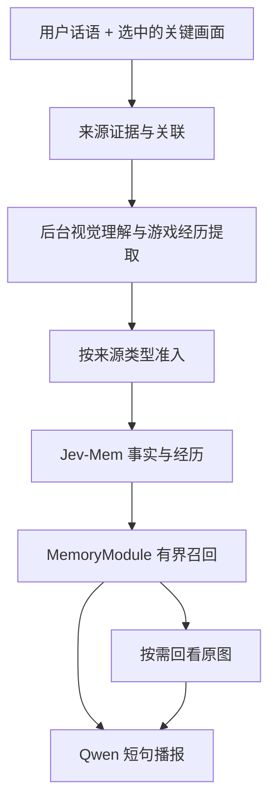

# PersonOS 与 BoxAgent 多模态记忆接入评估

调研及实现日期：2026-11-17。第一阶段已接入 BoxAgent 的生产装配和 MemoryModule，使用现有 Jev-Mem 内核；没有引入 PersonOS SDK 或其人脸、声纹依赖。

PersonOS 源码版本：`a394b65877546c20ab916b7d0344c791c8b17607`。
BoxAgent 对照版本：`6f8db78396772cf3d911941553d9cee1f0f8f524`。

## 结论

PersonOS 确实实现了可选的图片、视频记忆，并具有跨片段人物关联。它最值得 BoxAgent 借鉴的是：结合当前对话理解图片、保存可回看的来源、关联同一事件后续的变化，以及让宿主 Agent 自行组织召回材料。

已保留 Jev-Mem 和 MemoryModule，增加关键画面来源、后台经历提取、同主题历史链和原图回看。工程链路及故障恢复已用可控素材测试；《鸣潮》真实关键画面的识别、回忆准确率和播报延迟仍待实测。PersonOS 的真实人物人脸/声纹模型需要单独评估游戏画面适配性。

## 0. 本分支已实现的补充

| 环节 | 已实现行为 |
| --- | --- |
| 明确保存 | 用户开启屏幕观察，说“记住这套配队 / 这张截图”后，读取该条真实用户消息之前、45 秒内、相同前台应用和窗口的最新已理解关键帧。没有对应画面时简短提示；“保存昨天那张图”需要先打开原图，不能误存当前屏幕 |
| 来源留存 | 本地 `memory/media/` 保存缩略关键帧 PNG、hash、时间、用户 Event / Session / Interaction 和当时观察。每张最多 4 MiB、400 万像素，默认媒体配额 128 MiB；相同图片共享文件，不同消息仍有不同来源身份 |
| 经历整理 | DeepSeek 文本模型根据用户原话和本地视觉摘要选取 1–6 条连续原文引用；引用来源必须匹配，不能扩写成新的事实。输出无效时退回有来源的观察引用，游戏和版本不推测 |
| 统一内核 | Jev-Mem 保存 EPISODE、可检索的 EVENT 事实和 CONTAINS 关系；同游戏、同主体、同方面、同形态的经历按时间关联。时间关系不表示原因，历史装备不自动成为永久画像 |
| 按需回看 | 先召回真实记忆 ID，再带当前问题重读已保存图片，复用本地视觉模型，不重新截屏。摘要遗漏的细节有机会补读；看不清或超时会说明不足 |
| 语音回复 | Qwen 记忆工具回复默认一两句、30–60 个中文字，不念内部 ID。保存立即返回“画面已留存，正在整理这段经历”，后台完成事件单独记录，不提前宣称完成 |
| 查看和删除 | 记忆面板的“查看当时画面”默认折叠，展开才读取图片。删除此画面经历会覆盖它的事实、图关系、索引和无其他引用的图片；删除标记防止重试写回，重启继续完成未确认的清理 |
| 恢复 | 已提取的经历持久保存后才提交，重试复用相同结果和来源 ID；确认丢失不会重复建节点。未完成工作重启恢复，最多尝试 3 次；通知记录失败不撤销已提交记忆 |

实现入口：`domain/memory/visual.py`、`application/visual_memory.py`、`infrastructure/persistence/visual_evidence.py`、`infrastructure/memory/visual_extractor.py`、`visual_episode.py`。生产实例在 `bootstrap/memory.py` 和 `bootstrap/engine.py` 装配；UI、语音和应用统一经过 MemoryModule。

使用示例：开启屏幕观察，停留在需要记住的配队页，等待本地观察完成后说“记住这套配队”。之后问“上次那张配装图里的武器是什么”。没有识别到的角色名不能补造；用户可以在长期记忆面板检查来源并删除整段经历。

数据边界：保存的是屏幕观察使用的缩略关键帧，默认最大边 960 px，细小文字可能已经丢失。图片留在本地；用户原话和视觉描述发给配置的 DeepSeek 文本模型，索引文本沿用现有决策模型 / embedding 服务。视觉观察与用户陈述分别标记。本轮没有读取真实 Key 或用户记忆，没有录音、播音或截取用户桌面。

尚未实现：连续视频与动作片段、游戏实体库和可靠角色识别、跨片段人脸 / 声纹身份、以当前图片直接查询历史图片，以及由模型确认的新旧状态冲突。当前 DMG 尚未重新构建。

## 1. PersonOS 实际实现了什么

| 能力 | 源码行为 | 对 BoxAgent 的意义 |
| --- | --- | --- |
| 图片写入 | 保存图片，结合近期对话调用视觉模型，把描述与用户说明一起形成证据，再提取情景和原子记忆 | “记住刚才这套配队”可以拥有画面来源 |
| 原图回看 | 深度召回可以带着当前问题重新读取原图，补充首次描述漏掉的细节 | 摘要没写武器名称时，有机会回看来源；前提是检索先找到了有关证据 |
| 图像辅助查询 | 解析图中人物、场所、物体或文字，再把指代改写成可检索文本；不确定身份可以不匹配 | 解决“这个角色 / 那套装备”，但游戏实体识别要专门实现和验收 |
| 视频记忆 | 片段生成对白、动作、环境记录，归属到人物，结束会话时写入情景和原子记忆；记录原视频引用 | 支持经历回忆的方向成立，首版关键帧可以先验证收益 |
| 人物关联 | 使用人脸、身体画面、声纹与多模态模型关联人物；跨片段积累草稿，结束时提交身份 | 更适合真实人物视频；不能据此宣称支持《鸣潮》角色可靠识别 |
| 记忆链 | 把同一主体、同一方面的后续陈述追加到同一链，保留旧记录 | 可借鉴“上次配队 → 这次换队 → 后来结果”的时间关联 |
| 材料召回 | `flash` 跳过答案生成和复核，返回情景材料；仍需 embedding 和可选 reranker | 由 BoxAgent 负责短句播报，避免另一个系统先生成长答案 |

主要记忆路径是：多模态输入 → 文本化证据 → 情景 / 原子记忆 → 文本向量检索 → 按需回看媒体。人物身份模块另有脸部 / 声纹特征。不能把它描述为全部图像、声音、视频都在一个通用多模态向量空间中检索。

图片理解失败时，图片可能仍然保存，但不因此获得可检索的视觉内容。记忆链依赖模型判断，也不能自动证明某个新状态取代了旧状态。

## 2. 与 BoxAgent 接入前的差异

以下依据生产入口和实现核对，不只依据设计文档。

| 层 | BoxAgent 接入前实现（对照版本） | 可以补充的部分 |
| --- | --- | --- |
| 来源 | Product Session 保存用户原话；自动准入只处理 `message.final(user)` | 图像证据引用及其与用户话语的时间关联 |
| 个人事实 | Jev-Mem 准入、类型、图、关键词及向量检索 | 新的视觉观察准入规则与可追溯实体 |
| 用户画像 | 从被接纳的记忆派生字段，保留来源 ID；删记忆会撤销相关字段 | 区分长期偏好与临时游戏状态，避免一张画面永久更新画像 |
| 经历 | Context Checkpoint → Narrative；checkpoint 主要由已完成文本消息触发 | 针对短游戏经历、关键画面和明确结果生成 episode |
| 当前屏幕 | 本地视觉模型观察前台窗口，截图临时保存并随本轮删除；摘要有新鲜度校验 | 在专门启用经历记忆后选择性保存证据；已有屏幕观察不等于持久化记忆 |
| 召回 | 每轮有界 direct recall，复杂问题主动 deep recall；已有紧凑语音上下文包 | 以游戏 / 实体 / 时间 / 形态筛选经历；需要时回看原图 |
| 事实变化 | 内核有关联、重复和矛盾关系；产品尚缺完整冲突确认流程 | 明确事实有效时间和当前状态，并保留历史证据 |

BoxAgent 已经拥有来源、画像和多层检索。PersonOS 的新增价值集中在多模态证据与经历关联；画像本身不是当前缺失的核心能力。

源码入口：

- `boxagent/application/memory_ingestion.py`：只从用户 final message 获取自动准入输入。
- `boxagent/application/memory_narrative.py`、`context_checkpoint.py`：文本 checkpoint 与 Narrative 投影。
- `boxagent/infrastructure/perception/qwen_mlx.py`：临时截图、本地推理和过时窗口结果丢弃。
- `boxagent/application/memory.py`、`domain/memory/service.py`：统一边界和紧凑召回上下文。
- `boxagent/infrastructure/memory/jev_mem/core/memory_builder.py`：重复、矛盾、关联与 consolidation。

## 3. 最适合我们先验证的产品场景

### 场景 A：明确记住配队

用户打开配队页面，说“记住刚才这套配队，下次还用”。保存该次对话、匹配的关键画面和可辨认的队伍信息。

下次用户问“我上次用什么队打的这个 Boss”，先结合当前游戏、Boss 形态和时间召回。已确认队伍时用一两句播报；某个角色看不清时确认，不能补造完整队伍。

### 场景 B：共同经历

记录“当时尝试了哪种打法、用户说效果怎样、结算画面支持什么结果”。后续可以回忆“上次你说这个打法更顺手”。

单张死亡画面只能支持有限的状态观察，不能证明“连续失败三次”或“因为没躲开某一招而失败”。次数需要连续证据，原因需要对应片段或用户说明。用户说明、视觉观察和模型推断应分别标记。

### 场景 C：带着问题回看

用户问“上次那张配装图里武器是什么”。先通过当时的经历找到证据，再按需回看原图。

保留原图可以补足摘要遗漏，但文本索引完全没捕获相关线索时仍可能找不到图；这需要单独验收，不能把“能回看”当作“任何画面细节都能搜到”。

## 4. 接入分层与后续扩展

以下保留调研时的扩展设计。首版实际字段与能力以第 0 节为准；用户选择外部截图、专门的多模态开关、推断置信度和状态冲突确认仍属于后续项。



生产装配仍放在 `boxagent/bootstrap/`。视觉模型和媒体存储是 infrastructure 实现，domain 定义类型和端口；Qwen、Codex、UI 继续消费 MemoryModule。

### 4.1 增加有类型的来源记录

建议增加 `VisualMemoryObservation` 和 `MediaEvidenceRef`，至少包含：

- 来源 Event、Session、Interaction ID，采集时间、应用 / 窗口身份。
- 模态、媒体引用、内容 hash、处理模型 / 提取版本。
- 游戏名、实体 ID / 名称、Boss 形态、平台；游戏版本可为空，不能猜测。
- 用户原话、视觉观察、推断分别保存；置信度和确认状态独立于文字内容。
- 涉及当前装备、数值或攻略时的适用时间、版本范围和过期状态。

媒体存储只保存来源材料，事实和经历仍由 Jev-Mem 统一拥有。不能把视觉描述伪装成 `role=user` 再送进现有自动写入接口。

### 4.2 首版先处理明确触发的关键画面

先支持“记住刚才这个”以及用户选中的截图。在专门启用该功能后，再考虑会话结束时选取少量有意义画面。直接复用当前本地视觉能力作为候选实现，真实效果需要用《鸣潮》素材验证。

现有临时截图默认不变成长期留存。持久化经历需要明确设置、存储配额、可查看和可删除的来源；删除必须覆盖相关索引、派生画像和不再被引用的媒体，并阻止待处理 job 重新写回。

### 4.3 关联经历及其变化

在现有图中按“同一游戏 + 同一实体 + 同一方面”关联相关记录。队伍、装备和通关结果是不同方面，不能仅因主题接近就合并。旧事实保留，当前事实按照可验证的时间和用户确认选择。

公共攻略继续保留网页来源和适用版本；用户实际采用的办法、主观反馈和明确经历才投影成个人记忆。网页里的建议不能自动成为“用户做过”的事情。

### 4.4 为语音保留短路径

实时响应使用当前 MemoryModule 的有界召回，返回少量事实 / 经历及来源 ID，让 Qwen 组织一两句口语答案。图片重读、多步深度检索作为按需路径；超时或证据不足时简短说明，不编造经历。

PersonOS `fast/auto` 涉及历史构建、查询处理、答案生成、复核甚至深度召回，不能直接用它的默认完整答案路径替换实时语音检索。`flash` 的材料接口值得借鉴，但 embedding / rerank 也有调用成本；图像查询不支持 `flash`。

## 5. 接入成本和限制

| 项目 | 实际影响 |
| --- | --- |
| Python / 许可 | PersonOS 支持 Python 3.10+，包含 3.12；框架 Apache-2.0。复制具体代码时仍需保留许可与归属。外部模型权重许可另算 |
| 模型 | 文本核心要求对话模型与 embedding；多模态需要视觉 / 视频模型。DeepSeek Key 本身不能提供这些全部能力 |
| 打包 | 人脸后端新增 ONNX / InsightFace 等依赖；声纹后端引入 PyTorch / torchaudio。会显著增加 macOS ARM 包体与打包验证成本 |
| 视频接入 | 官方示例中的远端视频模型按 URL 拉取视频；本地文件路径本身不能供它读取。默认 local store 需要可访问媒体前缀或其他兼容传输 |
| 删除 | 当前公开接口 `reset(user_id=...)` 不覆盖待处理队列和外部媒体；按会话删除仍暂缓，不能直接继承为完整删除能力 |
| 评测 | 官方列出历史 M3-Bench / Video-MME / 文本记忆分数，但声明当前升级后未重测，配置和逐题产物不完整；不能据此认定优于 Jev-Mem 或适配游戏 |

因此本轮建议借鉴分层和来源回看设计，以现有记忆内核实现第一阶段。是否采用 PersonOS SDK 作为替换后端，需要独立进行准入、删除、延迟、包体与迁移评估。

## 6. 低成本验收及继续条件

先准备 10–20 组经人工核对的《鸣潮》公开 / 自有测试素材，覆盖配队、配装、Boss 不同形态、用户反馈、后续修改和不确定画面。

比较现有“文本记忆”与“文本 + 关键画面经历”两个版本，使用相同语言模型、问题和输出长度。第一批用预先选好的画面，减少自动采集策略的干扰。

拟定继续条件（这些是拟议门槛，还不是实测成绩）：

1. 每条视觉记忆都能追到正确画面及对应用户 Event；来源错配为零。
2. 明确可回答的配队 / 配装跨会话问题至少 90% 正确；不确定问题正确确认或拒答至少 90%。
3. 覆盖角色 / Boss 形态混淆、旧配队与新配队冲突、漏读文字；无证据的经历和因果陈述为零。
4. “来源描述没提到、原图有细节”的回看测试单独统计，暴露索引和视觉重读各自的失败。
5. 实测 MemoryService 的实时召回总延迟与降级率：当前默认外层召回超时为 2.0 秒，Jev-Mem direct 图遍历内部预算为 0.30 秒，不能将它们混为整条链路延迟。后台提取和原图重读的模型调用数、耗时与留存体积另记。
6. 删除、重启、后台重试和已切换窗口的过时结果验收通过。
7. 答案默认一两句；用户说“再说一遍”或询问来源时可以使用已召回材料。

先过来源、跨会话效果和语音延迟门槛，再投入视频理解、连续事件检测或更多视觉检索后端。若关键帧方案收益不足，应先修复实体识别 / 来源关联，而不是扩大采集量。

## 7. 调研证据

- [PersonOS 中文介绍](https://github.com/2049lab/PersonOS/blob/a394b65877546c20ab916b7d0344c791c8b17607/README.zh-CN.md)
- [框架分层、空结果、暂缓功能及删除限制](https://github.com/2049lab/PersonOS/blob/a394b65877546c20ab916b7d0344c791c8b17607/docs/framework.zh-CN.md)
- [图片写入与带对话的视觉理解](https://github.com/2049lab/PersonOS/blob/a394b65877546c20ab916b7d0344c791c8b17607/personos/online/write_path.py)
- [图像辅助查询](https://github.com/2049lab/PersonOS/blob/a394b65877546c20ab916b7d0344c791c8b17607/personos/online/visual_query.py)
- [原图按问题重读](https://github.com/2049lab/PersonOS/blob/a394b65877546c20ab916b7d0344c791c8b17607/personos/online/deep_recall.py)
- [视频事件与人物归属](https://github.com/2049lab/PersonOS/blob/a394b65877546c20ab916b7d0344c791c8b17607/personos/online/video_memory.py)
- [记忆链追加规则](https://github.com/2049lab/PersonOS/blob/a394b65877546c20ab916b7d0344c791c8b17607/personos/online/chain_build.py)
- [可选依赖与包体来源](https://github.com/2049lab/PersonOS/blob/a394b65877546c20ab916b7d0344c791c8b17607/pyproject.toml)
- [历史评测证据与复现限制](https://github.com/2049lab/PersonOS/blob/a394b65877546c20ab916b7d0344c791c8b17607/docs/evaluation.zh-CN.md)

在临时源码目录使用 Python 3.12、SQLite 与假模型验证图片写入、视频证据归属、图像查询、材料召回、记忆链、原图重读及能力契约：**79 passed, 1 skipped（9.22 秒）**。跳过项是缺少可选 `av` 时的视频能力诊断测试。这些测试验证代码行为，不代表真实多模态理解准确率；未使用 BoxAgent 的真实 Key 或用户记忆。

复现命令（在对应 PersonOS 源码目录执行）：

```bash
UV_CACHE_DIR=/tmp/uvcache PERSONOS_TEST_BACKEND=sqlite \
uv run --python 3.12 --extra deep --with pytest --with pillow --with fastapi \
python -m pytest -q \
  tests/test_image_input.py tests/test_video_memory.py \
  tests/test_visual_query.py tests/test_flash_recall.py \
  tests/test_chain_build.py tests/test_capability_contract.py \
  tests/test_deep_image_look.py
```

本机日志：`/tmp/boxagent-personos-review-tests-complete.log`。

## 8. BoxAgent 首版验收记录

2026-11-17，本分支完成以下检查：

| 检查 | 结果与证据边界 |
| --- | --- |
| Python 必需检查 | `uvx --from pyright==1.1.414 pyright`：0 errors；现有 PyAudio source warning 1 项 |
| Python 全套测试 | `UV_CACHE_DIR=/tmp/uvcache uv run --with pytest python -m pytest -q`：501 passed、13 skipped、99 subtests passed |
| 视觉记忆专项 | 覆盖实际 vendored NetworkX 图序列化和 EpisodeNode、原文引用校验、跨会话来源回看、相同图片不同来源、乱序历史链、取消后恢复、确认丢失后幂等重试、完整来源删除、删除后禁止重写、历史图片请求确认及未提交材料过滤 |
| 前端 | `pnpm --dir web/panel test`：72 passed；`pnpm --dir web/panel build` 成功 |
| 真实 Renderer / Preload | 使用自动生成的公开合成布局素材，验证图片展开才读取、明暗主题的来源卡片在视口内且不溢出，以及删除后整组节点即时消失。已人工查看明暗两张截图 |

Renderer 验收在本机 macOS 执行：

```bash
pnpm --dir web/panel build
cd web/panel
pnpm exec electron tests/memory-source-smoke.cjs
```

产物位于 `.runtime/visual-memory/ui/`：`fixture.png`、`light.png`、`dark.png`、`evidence.json`，不提交用户运行目录。测试脚本从空目录自行生成素材，不依赖用户记忆或桌面截图。

本机日志：`/tmp/boxagent-visual-memory-tests-release.log`、`/tmp/boxagent-visual-memory-types-release.log`、`/tmp/boxagent-visual-memory-panel-tests-release.log`、`/tmp/boxagent-visual-memory-renderer-release.log`。

这些结果证明来源绑定、图存储和恢复 / 删除契约，不证明真实《鸣潮》OCR、人物识别、模型回答准确率或设备上的语音时延。模型 / embedding 在图链路测试中使用可控边界；完整真实模型及设备播报仍需按第 6 节单独验收。
