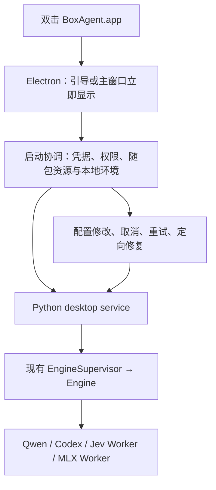

# BoxAgent 首次引导与 macOS 打包实施方案

日期：2026-11-17。状态：首次引导与打包实现已落地，成品验证记录见 [macOS 安装包说明](../macos-distribution.md)。

用户已确认首版面向 **macOS Apple Silicon**，交付 `.app` / `.dmg`。目标是让新用户双击打开界面，在界面内完成凭据、组件准备和授权；开发环境继续支持现有脚本入口。Windows 后续单独规划。

## 1. 参考基线与当前事实

本次参考 MiraJelly **release 分支的生产代码**，不是旧视觉原型。已实时核对本地分支、干净工作区和远端 HEAD：`6876199761af930d238c08abb18f2bb98e30358e`。BoxAgent 基线是本地与远端一致的 `main`：`2cafaaae4759ec3cae0d15a63c9c19cde1e258a6`。

| 项目 | 当前代码事实 | 对本项目的含义 |
| --- | --- | --- |
| MiraJelly 引导 | `app/shared/onboarding.ts` 的 flow version 为 6；当前流程为 setup → 可跳过的 dictation → personalize → know-you → permissions | `docs/onboarding/README.md` 描述的是历史流程；复制实现时以 shared contracts、policy、入口服务和当前页面为准 |
| MiraJelly 状态 | `app/electron/services/onboarding-state.ts` 校验和迁移保存状态，用临时文件、sync、rename 写入；完成前检查由独立策略和服务负责 | 可以参考“流程进度”和“真实能力”分离；不能只看 completed 或文件存在就宣布可用 |
| MiraJelly Runtime | `engine-runtime-coordinator.ts`、inspector、manifest、marker store 区分正常启动、源码更新、依赖同步和重建 | 参考恢复机制，避免每次启动都安装依赖，避免把 Engine 启动失败一律升级成环境重建 |
| MiraJelly 打包 | Electron Builder 的 extraResources、embedded Python、随包 wheel、原生签名、App/DMG 公证及成品检查 | 可以参考流水线；下载地址、版本、依赖锁、签名身份、发布地址必须使用 BoxAgent 自己的配置 |
| Python 版本 | MiraJelly 固定 3.13.11；BoxAgent 要求 `>=3.12,<3.13`，源码安装目前用 3.12.9 | 不复制 MiraJelly 的 Python 包或 wheel 清单；重新解析和核验 CPython 3.12 arm64 依赖 |
| BoxAgent UI | `web/panel/main.cjs` 是 Electron 入口；`ServiceClient` 启动无界面的 Python desktop service，再由后者监督 Engine | 引导和修复界面必须在 Electron 内、在 Python 可用前打开；维持现有服务边界 |
| BoxAgent 本机 app | `web/panel/scripts/launch.cjs` 从依赖 Electron.app 复制并 ad-hoc 签名；仍传入源码路径和 Python 环境变量 | 当前 BoxAgent.app 是开发启动缓存，不能作为独立发行包交付 |
| BoxAgent 安装 | `scripts/install.sh` 依赖 uv、Node、pnpm、Git LFS、PortAudio 等，且 Codex/Computer Use 另行准备 | 不能从首次引导直接调用整个开发安装脚本；构建工具依赖必须移到制作机器上 |
| BoxAgent 路径 | `bootstrap/settings.py`、`main.cjs`、`bootstrap/electron.py` 仍以源码根目录和 `.runtime` 推导资源、模型和用户目录 | 需要独立的资源路径、用户数据路径、运行环境路径合同 |

此前 [Onboarding 与启动就绪设计](../BoxAgent-Onboarding-与启动就绪设计.md) 的能力分级、Repair、secret 边界仍可参考；AppKit 窗口、旧启动链路和建议目录已经过时，本方案采用 Electron。

本轮只做静态源码审阅及 Git 状态核对，没有运行 MiraJelly 的构建、公证或真实首次安装，因此不将其历史发布报告当作本次验证结果。

## 2. 复用方式与必须先解决的约束

BoxAgent 的目标 GitHub 仓库经查询为 PUBLIC，MiraJelly 来源为内部仓库，未找到项目级 LICENSE。**本轮提交设计方案，不复制内部仓库代码或二进制。** 后续直接复用代码需先确认具体文件的可公开范围、归属和必要的署名；未确认部分依据行为合同独立实现。第三方资源各自检查许可证。

| 可参考的 MiraJelly 文件 | 迁移内容 | BoxAgent 适配点 |
| --- | --- | --- |
| `app/shared/onboarding.ts`、`onboarding-policy.ts` | 版本化状态、完成失败原因、显式步骤依赖 | 使用 BoxAgent 的 Key/Workspace、Jev、MLX 和 Runtime；不带入账户连接、听写模型或画像流程 |
| `app/electron/services/onboarding-state.ts`、`onboarding-entry-state.ts` | 进度恢复、原子保存、首次与维护入口 | 首次 setup 与已有用户 repair 分开；迁移失败不自动覆盖用户配置 |
| `app/src/routes/onboarding/` | 分步页面、准备进度、取消重试、错误展示 | 使用现有 React、i18n 和样式体系；不迁入整个 MiraJelly App Shell |
| `app/electron/services/engine-runtime-*`、`engine-python-bootstrap.ts` | 随包运行时检查、复用、受控修复、退出取消 | BoxAgent 有 core/Jev/vision 隔离环境；沿用 desktop service → Engine 的监督关系 |
| `scripts/fetch-embedded-python.sh`、`prepare-packaged-engine-runtime.sh`、`prepare-python-dependencies.py` | 制作阶段准备解释器、锁定 wheel、资源摘要 | 重建 Python 3.12 的输入与哈希；核验 PortAudio、PyObjC、Torch/FAISS、MLX 等原生链路 |
| `scripts/build-dist-mac.sh`、`create-release-dmg.sh`、`release-notarization.mjs` | 分阶段构建、由内向外签名、App/DMG 公证、失败恢复 | 固定 BoxAgent app ID、签名配置和产物；首版不用 MiraJelly 的 CDN 和自动更新发布配置 |

优先采用现成能力：Electron Builder 负责 app 资源布局；Python 官方包管理能力负责 venv/依赖安装；Electron `safeStorage` 或明确的 macOS Keychain 适配负责凭据；系统 API 负责 TCC 查询。项目只编排生命周期、能力状态和产品策略，不自写逐包复制安装器、通用密钥加密或另一套进程监督器。

首个技术验证必须明确以下条件，否则不能承诺完整新机体验：

1. **Python 原生依赖**：3.12 arm64 的完整锁、可用 wheel 和动态库闭包成立；不能携带制作机器 venv、Homebrew 路径或源码绝对路径。
2. **Codex 与 Computer Use**：Codex、同版本 code-mode host 和官方 Computer Use 的来源、兼容性、再分发方式、授权主体均须核查。现有文档明确这些组件不随仓库提供；无法随包时要验证官方 GUI 安装路线，产品显示桌面任务受限。若仍需终端手工安装，则尚未满足完整桌面任务 onboarding 验收。
3. **AOQ**：官方 Framework 来源已有下载和摘要检查，但随包分发、嵌套代码签名和运行兼容性仍需验证；不把 WebSocket 诊断降级算作 AOQ 全双工验收。
4. **身份与系统版本**：以现有 `com.boxagent.desktop` 为候选固定 app ID；权限查询/申请必须对应真实执行者。最低 macOS 版本在 wheel、MLX 和原生组件检查后确定，不能照抄 MiraJelly 的支持范围。
5. **密钥模式**：首版按用户自带 Key 配置，不创建账户服务，不在包里写入团队共享 Key。若以后提供团队代付语音服务，再独立实现服务端短期 Token 下发。

## 3. 产品流程与完成条件

首次引导建议：**欢迎 → 模型服务配置 → 本地组件准备 → 系统权限与能力测试 → 开始使用**。可选形象选择链接到已有形象设置；人格编辑沿用已有功能，不在本期重新开发。

| 步骤 | 用户操作 | 通过条件 |
| --- | --- | --- |
| 欢迎 | 了解聊天、记忆、语音和电脑任务；选择语言 | 界面可立即显示，无 Python/Engine 依赖 |
| 模型服务 | 输入 DashScope Key、百炼 Workspace ID；默认决策服务复用同一组配置；可配置 DeepSeek 或已有 Codex 登录 | 字段校验和受限真实连通/鉴权检查；网络失败与凭据无效分别展示 |
| 本地组件 | 查看空间需求、来源、联网需求；准备 core/Jev/vision、记忆 embedding 和默认视觉模型 | 锁和文件摘要通过，core 服务及必要组件的基础 health probe 通过；暖加载可后台继续 |
| 权限与测试 | 逐项授权，或选择文字模式；测试文本往返，可选语音和桌面任务测试 | 重新查询系统真实状态；测试结果按能力显示，不伪造全部 ready |
| 开始使用 | 查看可用项与受限项 | 最终重新检查核心能力后原子写 completed；进入现有桌宠、对话和控制台 |

沿用旧方案已经明确的要求：**Jev-Mem 与默认本地视觉模型首次完成前必须准备并通过基础健康检查**；本轮不擅自改为可跳过。Core service/Engine、Qwen 配置和基础文字对话也是完成门槛。

语音可选择稍后启用；缺少麦克风权限时保留文字模式。桌面任务配置与 Accessibility/Screen Recording 不完整时按能力降级，不阻断已经可用的文字聊天；本地视觉组件已准备不等于已获得读取屏幕权限。摄像头默认关闭，在用户首次开启摄像头时申请权限。Input Monitoring 是否必要由快捷键实现决定，不能照搬另一产品的权限清单。

“正常进入应用”与“完整桌面伙伴验收”分开记录：后者仍必须验证 AOQ 语音、真实记忆读写及合法安装的 Computer Use，不能用文字模式通过替代。

启动状态为 `checking / needs_setup / ready / degraded / repair`。已完成用户的能力故障进入定向 repair；Engine 重启保留 Electron 窗口和输入草稿。正常重开不重复安装依赖或下载模型；未完成引导恢复上一步。进度文件只保存版本、步骤与完成时间，权限和组件状态每次读真实来源。

## 4. 运行与打包布局



Electron 负责独立可用的 setup/repair 外壳、凭据界面和启动编排；Python 保留现有应用用例、Runtime 和 Engine 监督。新增 Python 生产依赖在 `boxagent/bootstrap/` 装配，遵守 `entrypoints → bootstrap → application/domain/agent ← infrastructure`。Host 不通过 Engine 来保存启动所必需的凭据。

建议布局（实际打包清单由首个验证冻结）：

```text
BoxAgent.app/Contents/
  MacOS/                         Electron 可执行入口
  Resources/app.asar             Electron CJS、preload、React 构建产物
  Resources/boxagent/             Python 业务源码与必需脚本
  Resources/python/              固定 CPython 3.12.x
  Resources/python-dependencies/ 各组 wheel、锁与摘要
  Resources/assets/              默认 VRM、动作、默认 persona、licenses
  Resources/skills/              内置 skills
  Resources/native/              经验证允许分发的原生资源
  Resources/runtime-manifest.json

~/Library/Application Support/BoxAgent/
  state/                         引导状态、非敏感配置、加密凭据文件
  runtimes/                      core / jev / vision venv、隔离 Codex home
  models/                        embedding 与视觉模型
  sessions/ memory/ skills/       现有产品数据
  logs/                          脱敏诊断
```

发布模式从 `process.resourcesPath` 与用户目录解析路径，资源只读；开发模式继续使用源码根目录和 `.runtime`。`Settings.root` 不再兼任用户缓存目录。尤其修改 PetCatalog 的导入目录、Jev/vision 解释器及 AOQ 工作目录。包启动默认进入完整桌宠模式，不依赖外部注入 `--desktop` 或 `BOXAGENT_DESKTOP_PYTHON`。

公共 Python 依赖尽量随包并离线安装；MLX 的系统差异先验证再决定是否联网选包。模型大文件优先使用固定 revision/摘要的界面下载，显示真实字节、磁盘检查、取消和重试；只有服务器支持 Range 且对象身份一致时才断点续传。不能把本地安装进度显示成网络下载进度，也不能宣称云服务离线可用。

凭据方案先对比 Electron `safeStorage` 与直接 Keychain：macOS safeStorage 的加密密钥由 Keychain 保护，API Key 本体保存为用户目录中的加密数据；这与“每个 API Key 直接作为 Keychain item”不同，最终实现应明确选择。Renderer 只通过受限 IPC 保存/删除，不提供读取完整 secret 的通用接口；Host 通过受控子进程环境传入所需项，配置变化重启相关服务，日志与错误脱敏。Keychain 锁定或读取失败返回可修复状态。

原生签名从内到外执行。Python 可执行文件、`.so` / `.dylib`、AOQ Framework 和可分发 helper 均纳入检查。若 wheel 内部原生文件须重签，应保留上游与派生摘要、按 wheel 标准重建 RECORD，并更新离线锁，不能继续冒用原始 hash。所有可执行资源打包后保持只读，模型/环境下载写入用户目录。

## 5. 分阶段实施与验收

以下为单人连续开发的粗估，不是交付承诺；第三方分发、系统权限和公证问题需独立计时。

| 阶段 | 粗估 | 交付与退出条件 |
| --- | --- | --- |
| P0：可行性验证 | 0.5–1.5 天 | 最小打包 app 在源码移走、无系统 Python/开发工具 PATH 的环境显示窗口并启动基础 Python service；盘点 3.12 wheels、PortAudio、AOQ/Codex 来源和分发约束；失败先修路线 |
| P1：正式启动与路径 | 1–2 天 | Electron 先启动；冻结只读资源/用户目录；独立 setup/repair；开发入口回归；稳定 app ID |
| P2：组件与能力合同 | 1.5–3 天 | 运行时 manifest、隔离环境、复用/更新判断、组件安装/下载、真实 capability snapshot、受限凭据存储；中断后可恢复 |
| P3：Onboarding 集成 | 1–2 天 | 五步 React 引导、i18n、准备进度、授权刷新、测试与完成门禁；Settings 复用同一能力接口 |
| P4：内测包与正式分发 | 1–2 天 + 公证等待 | 本地完整 app/DMG；成品检查；Developer ID、hardened runtime、App/DMG 公证与 staple；新用户及已有用户实机验收 |

先取得 P0 结果，再承诺完整开发时间。无签名凭据时可以交付本地测试包，但不能将其称为正式签名公证包。首次不做自动更新；先验证替换 app 的手动更新能复用环境和用户数据，再扩展更新渠道。

建议后续提交按依赖顺序拆分：`runtime-paths` → `packaged-runtime` → `startup-capabilities` → `onboarding-ui` → `mac-distribution`。每个提交附对应验证，持续推到同一开发分支。

## 6. 预计文件影响

以下是粗略文件级新增/修改行数，路径为拟定路径；P0 后校准，测试代码另列。删除量暂估为 0，不把内部项目的整套实现按文件拷入。

| 普通代码文件 | 新增 | 修改 | 用途 |
| --- | ---: | ---: | --- |
| `web/panel/package.json` | 15 | 8 | Electron Builder 与打包命令 |
| `web/panel/electron-builder.cjs` | 90 | 0 | app ID、资源白名单、权限声明、产物 |
| `web/panel/main.cjs` | 35 | 40 | 仅接入路径与启动模块，避免入口继续膨胀 |
| `web/panel/preload.cjs` | 20 | 5 | 受限 setup IPC |
| `web/panel/desktop/service-client.cjs` | 15 | 20 | 正式 Python 路径、受控配置与重启 |
| `web/panel/startup/contracts.ts` | 90 | 0 | UI 能力状态与动作类型 |
| `web/panel/startup/paths.cjs` | 70 | 0 | 开发/发布资源与数据目录 |
| `web/panel/startup/coordinator.cjs` | 150 | 0 | 首次、重开、修复与取消编排 |
| `web/panel/startup/state-store.cjs` | 80 | 0 | 版本化进度与原子写入 |
| `web/panel/startup/credentials.cjs` | 90 | 0 | 系统凭据保护与脱敏 |
| `web/panel/startup/runtime.cjs` | 170 | 0 | 环境准备、复用及 manifest 校验 |
| `web/panel/startup/download.cjs` | 100 | 0 | 固定来源模型下载、取消、重试 |
| `web/panel/startup/permissions.cjs` | 75 | 0 | 对应执行者的权限查询与引导 |
| `web/panel/src/onboarding/OnboardingPage.tsx` | 180 | 0 | 五步外壳与分项操作 |
| `web/panel/src/onboarding/RepairPage.tsx` | 65 | 0 | 定向修复 |
| `web/panel/src/onboarding/useStartup.ts` | 75 | 0 | UI 状态订阅和动作边界 |
| `web/panel/src/onboarding/onboarding.css` | 110 | 0 | 现有设计体系内的引导样式 |
| `web/panel/src/App.tsx` | 15 | 15 | 路由接入 |
| `web/panel/src/pages/SettingsPage.tsx` | 25 | 10 | 复用配置与修复入口 |
| `web/panel/src/locales/en.json` | 70 | 0 | 引导、安装和错误文案 |
| `boxagent/bootstrap/settings.py` | 35 | 30 | 发布配置/环境路径，显式边界类型 |
| `boxagent/bootstrap/electron.py` | 10 | 12 | 用户宠物目录与资源目录分离 |
| `boxagent/interfaces/engine/protocol.py` | 25 | 5 | 受限能力查询协议 |
| `boxagent/interfaces/engine/server.py` | 25 | 10 | 能力查询接入现有用例 |
| `boxagent/application/startup/capabilities.py` | 100 | 0 | 不依赖具体 SDK 的能力合同与策略 |
| `boxagent/infrastructure/system/startup_probes.py` | 100 | 0 | Python 组件基础 health probe |
| `boxagent/bootstrap/startup.py` | 40 | 0 | 生产 probe 装配 |
| `scripts/prepare-packaged-runtime.py` | 150 | 0 | 制作端资源准备、锁、摘要、原生输入 |
| `scripts/build-dist-mac.sh` | 90 | 0 | 构建与签名公证编排 |
| `scripts/verify-packaged-app.mjs` | 100 | 0 | 成品资源、路径和依赖检查 |
| `scripts/create-release-dmg.sh` | 45 | 0 | DMG 布局与制作 |
| `.github/workflows/verify.yml` | 65 | 0 | 分支验证；原生打包由可用的 arm64 macOS 环境执行 |

预计普通代码新增约 2325 行、修改约 155 行，总计约 2480 行；测试预计新增约 660 行。需分阶段实现和审阅，不是一次复制即可完成。各表项数字是预算而非实测 diff。中文页面沿用现有 `t()` 调用方式，英文统一补入 `src/locales/en.json`，不为引导新建第二套词库。

| 测试文件（拟定） | 新增 | 修改 | 实际风险覆盖 |
| --- | ---: | ---: | --- |
| `web/panel/tests/startup.test.cjs` | 130 | 0 | 首次、重开、进度恢复、最终能力门禁 |
| `web/panel/tests/packaged-runtime.test.cjs` | 140 | 0 | 错误资源前置保护、环境复用、更新、中断 |
| `web/panel/tests/credentials.test.cjs` | 60 | 0 | 无明文回读、存储失败、日志脱敏 |
| `web/panel/tests/onboarding-smoke.cjs` | 100 | 0 | Engine 不可用仍显示和配置、完成后切换桌宠 |
| `tests/test_startup_capabilities.py` | 90 | 0 | 明确错误分类、组件健康、协议边界 |
| `tests/test_packaged_paths.py` | 70 | 0 | 只读资源、自定义用户目录和源码入口兼容 |
| `scripts/test-release-mac.sh` | 70 | 0 | 制作前后输入、签名/公证失败停止 |

## 7. 验证与交付边界

Python 改动完成前必须按仓库要求执行：

```sh
uvx --from pyright==1.1.414 pyright
UV_CACHE_DIR=/tmp/uvcache uv run --with pytest python -m pytest -q
```

Python 制作工具与本地 Python 命令统一使用 uv，目标 3.12.x，不弱化类型检查。正式 app 使用随包解释器启动用户服务，不要求最终用户安装 uv。现有重型替身依赖如导致测试环境缺失，明确报告并补齐测试环境，不能用跳过全部测试代替验收。

前端执行 `pnpm --dir web/panel build` 与 `pnpm --dir web/panel test`；新增打包命令另执行真实 app 生成及成品校验。CI 计划先为分支加入 Linux 的纯逻辑/类型检查，macOS arm64 负责实际原生构建；签名 secret 使用独立配置，正式发布作为单独动作。

成品验收必须覆盖：

- 干净 macOS 用户或独立测试机，无源码 checkout、系统 Python、uv、Node、pnpm、Homebrew 时双击启动；PATH 模拟只能作早期筛选，不能替代新机测试。
- 路径包含空格、app 移到 `/Applications`、源码移走、只读 app 资源；不访问制作机器的用户目录。
- 首次正常配置；错误 Key/Workspace、网络超时、磁盘不足、组件损坏；取消后重开恢复；日志无凭据。
- Engine 完全无法启动时，setup/repair 仍可见、可保存配置和重试；任一完成门槛失败时不能写 completed。
- 麦克风/屏幕录制/辅助功能拒绝和系统设置返回后刷新；权限确实授予正确执行者；按需开启摄像头。
- 已完成用户重开不重复安装；仅业务源码更新不重建健康环境；修复不删除 Session、记忆、skills、persona 或模型。
- 真实文字往返、AOQ 语音、Jev 保存并召回、合法安装的 Computer Use 完成一项可撤销测试任务；按项记录结果。
- `codesign --verify --deep --strict`、`spctl --assess`、App/DMG 的 `stapler validate` 及实际从下载文件安装。

最终可交付物为：开发分支与小提交、用户安装说明、macOS arm64 app/DMG、版本与资源摘要、第三方 notices、按场景验证记录。分支源码推送与二进制发布分开；大模型、wheel、用户数据和密钥不提交 Git。自动更新、账户/代付服务、Windows 不属于首版。

## 8. 分支安排与本轮完成范围

使用从已核对 main 基线创建的隔离工作树，分支名 `codex/onboarding-packaging`。原 BoxAgent main 工作区存在微信等未提交改动，保留原样；不 stash、不随方案提交，也不复制整个工作区。后续若确有必要依赖这些修改，再识别并单独迁移所需内容。

初始方案提交 `9326890` 已建立 upstream；用户随后要求沿用本分支完成实现并推送。现在该分支包含独立 Electron 引导、用户 Key 配置与修复、组件准备与健康检查、发布资源布局、macOS app/DMG 制作及验证脚本。推送前逐项检查 staged diff 和文件白名单，禁止 `git add .` 混入其他任务。

工作树使用独立 `.runtime`；测试与预览使用隔离用户目录，不接管或停止 main 中正在运行的产品。成品在制作机器上的隔离路径检查与新机、真实云模型、TCC、正式签名公证分别记录，不将一项通过推断为全部场景已通过。
