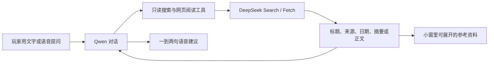

# 游戏攻略与联网资料

2026-11-17，首个验收游戏为《鸣潮》，用于 BoxAgent 宣传片。开发分支为 `codex/game-web-search`，基于已完成的 onboarding 分支 `f15e53a`。

## 接入结论

DeepSeek 已开放独立 Search、Fetch API，复用 `DEEPSEEK_API_KEY`，无需额外搜索供应商或第二个 Key。开源的 [chat-demo](https://github.com/deepseek-ai/chat-demo) 是演示客户端；搜索服务通过云 API 提供，并不意味着开源了搜索引擎供本地部署。

用户提供的知乎文章在本次读取时返回 403，未将文章正文作为已验证信息。接口、能力和价格以以下官方文档为准：

- [构建 Chatbot](https://api-docs.deepseek.com/zh-cn/guides/build_a_chatbot)
- [网页搜索与抓取](https://api-docs.deepseek.com/zh-cn/guides/search)，[Search Schema](https://api-docs.deepseek.com/zh-cn/api/search)，[Fetch Schema](https://api-docs.deepseek.com/zh-cn/api/fetch)
- [模型内置联网工具](https://api-docs.deepseek.com/zh-cn/guides/web_tools)
- [Files API](https://api-docs.deepseek.com/zh-cn/guides/files_api)，[价格](https://api-docs.deepseek.com/zh-cn/quick_start/pricing)
- [Codex 集成与 Alpha Search](https://api-docs.deepseek.com/zh-cn/quick_start/agent_integrations/codex)

本轮使用独立只读 API，保留 Qwen 的实时文字/语音前台。模型自行决定调用 `search_web` 或 `read_webpage`，应用校验参数、执行请求，再将外部资料返回当前对话。查攻略不依赖 Computer Use，不需要先启动浏览器或后台桌面任务。



## 边玩边听的交互

2026-11-17 继续完善了语音与资料展示。玩家默认听到一到两句口语，通常 30–60 个中文字、最多 80 字，英文最多 30 词。先说当前能用的动作及其时机，再补一个必要限制；资料只支持一点就只说一点。用户主动追问再展开，不一次播报整份攻略，也不念网址、引用编号或文章标题清单。

来源由应用根据真实工具结果绑定到 Interaction，保存为 `web.research.completed` 元数据；正文不写进这条产品历史事件，不变成一条要播报的长消息。桌面小窗和会话历史都显示默认收起的“参考资料”，打开后可以点击原文，分别查看“已读正文”“搜索摘要”“未能读正文”、文章日期和检索日期。这里显示检索参考，不能据此声称模型使用了每一篇文章。提问版本与“攻略适用版本待核对”分开显示；目前没有自动证明文章适配某个补丁。

查资料和读原文时有真实阶段提示；没有百分比或虚构剩余时间。插话或切换会话后，旧结果不能覆盖新回合，也不继续安排后续付费读取。已经发出的 HTTP 请求可能仍在服务端处理，取消本地等待不保证取消计费。

设计沿用 Apple Design 的 `writing.md › Getting started`（“Match your tone to the context”）和 `loading.md › Best practices`（“Let people do other things … while they wait”）：语音短、参考资料按需展开，等待时能继续聊天。实际采用 Electron 的原生 details、按钮、键盘焦点与 reduced-motion 样式。新增来源文字 13px、辅助文字 12px；来源卡片实测对比度：浅色正文 14.13:1、辅助文字 6.17:1，深色辅助文字至少 8.86:1。

## 首版已经实现

| 项目 | 行为 |
| --- | --- |
| 搜索 | `POST /v1/tools/search`，关键词 1–128 字，最多 5 条。《鸣潮》优先库洛社区 Wiki 与鸣潮 BWIKI 的路径，没有结果再扩大搜索 |
| 自动读原文 | 搜索后并行读取最多两篇，优先不同站点；读取失败时在同一预算内最多换一篇。每篇回传最多 5,000 字并标记截断，不能把多网页当作已验证的独立证据 |
| 阅读链接 | `POST /v1/tools/fetch`，显式阅读用户提供或搜索返回的公开 HTTP(S) 链接；正文最多回传 12,000 字，并明确标记截断 |
| 游戏判断 | 提示模型区分剧情、野外、全息、梦魇和周本；“这个 Boss”没有可用的命名上下文时，宿主在付费搜索前拒绝泛搜并返回一句澄清。无冠者与周本无妄者混用时增加本轮澄清参考 |
| 来源判断 | 提示模型判断标题/正文是否回答问题，关键打法尽量核对不同站点，版本更新优先查看官方公告；同站多个页面不是独立证据 |
| 失败处理 | 无结果、鉴权、余额不足、限速、网页不可读、协议错误分别反馈；模型不得把失败说成已查到 |
| 请求边界 | 每个对话回合共最多 4 次 Search/Fetch，包含扩大搜索与换来源；整次资料查询最多等待 25 秒，单次 HTTP 超时 20 秒，不自动重试付费请求 |
| 配置 | 默认启用并复用 DeepSeek Key；`BOXAGENT_WEB_SEARCH_ENABLED=0` 关闭。第三方模型网关必须同时支持独立工具接口 |

返回值携带检索时间和外部资料标记。发布时间、检索时间都不等于攻略适用版本；来源未知或冲突时需明确说明。没有自动把攻略写进用户长期记忆，也没有新增上传截图或文件的路径。

依赖保持 `bootstrap -> application/domain <- infrastructure`。WebProvider 协议和证据记录位于 domain，DeepSeek HTTP 适配器位于 infrastructure，生产依赖在 bootstrap 构造。没有安装第三方搜索 SDK，也没有复制 chat-demo 的实现。

当前前台已经接工具；后台 Codex 执行器的原生搜索没有开启。仓库的 Computer Use 基线为 Codex 0.153，官方 Alpha Search 需要 0.164+，需单独验证版本与 SDK 兼容后升级。DeepSeek 的模型内置联网工具还存在与 `custom` / `namespace` / `tool_search` 等工具的组合限制，不宜直接塞进现有 Code Mode 请求。

## 《鸣潮》如何验收

宣传片先选择固定 Boss 或任务、明确游戏版本与平台，再录制下面的场景：

1. “帮我查一下《鸣潮》野外普通形态无冠者的打断时机，只说两点。”应真实检索，给出一到两句有原文依据的建议；不能套用剧情、全息或梦魇形态。
2. “这套配队适合我当前版本吗？”应依据已知角色/版本核对；缺少关键信息时先询问，不自动套用最新数值。
3. 发送库洛攻略或 Wiki 链接，要求解释机制。应阅读原文；网页无法访问时说明，并可换另一条来源。
4. “最新版本这角色改了吗？”应查看官方公告或明确的版本说明，不能把搜索页面日期当成游戏补丁版本。
5. 网络失败、余额不足和无结果时，应明确未查到；不阻塞普通聊天，不伪造来源。
6. “再说一遍，更短一点”应复述现有建议；“来源是哪”只说站点简称，两者都不应重新搜索。
7. 新会话说“这个 Boss 怎么打”，以及错误组合“周本无冠者”，应先问一个确认问题，不发起付费检索。

此前选择“周本无冠者”作为台词不妥，已纠正。实测发现社区文章会将无冠者写成周本，或混用剧情版体术阶段与野外机制。库洛 Wiki 的[无冠者（敌人）](https://wiki.kurobbs.com/mc/item/1226961704338931712)明确说明野外没有体术步行姿态；[无妄者资料](https://wiki.biligame.com/wutheringwaves/%E5%A3%B0%E9%AA%B8/%E6%97%A0%E5%A6%84%E8%80%85)记录的是另一个敌人的声骸。优先游戏 Wiki 和宿主名称检查，能减少这一类错误，但仍不是全游戏知识校验器。

最后一轮使用真实 Qwen、DeepSeek、生产应用分发和独立 Product Session，生成了真实 PCM 语音；输入为公开文字台词，没有开启麦克风或扬声器：

| 场景 | 实测输出 | 搜索 / 抓取 |
| --- | --- | --- |
| 野外普通无冠者 | 51 字，语音 11.28 秒；约 4.48 秒开始返回最终答复音频，未念网址 | 一次搜索、两次读取 |
| 更短地复述 | 26 字，语音 5.60 秒 | 0 |
| 问出处 | 7 字，只说“来源是库街区” | 0 |
| 指代不清 | 16 字，询问游戏与 Boss 名字 | 0 |
| 无冠者 / 无妄者混用 | 16 字，询问是哪个敌人 | 0 |

原始语音和证据位于 `.runtime/web-research/voice-acceptance/`。这验证了真实音频生成、长度、文本内容和工具请求数；尚未验证现场 AOQ 设备播放、麦克风识别、游戏背景音下的打断体验。一次实测不是稳定延迟结论；之前同类查询曾需要约 19 秒才返回答复音频。

可复现命令：

```bash
uv run --python 3.12 python scripts/experiments/game_voice_smoke.py --live
pnpm --dir web/panel exec electron tests/web-research-smoke.cjs
```

Electron 验收运行真实 renderer 和 preload，使用隔离的公开数据 fixture；检查默认折叠、点击原文、明暗主题、340/400px 无横向溢出、减少动态效果及旧会话来源不串入新会话。截图人工逐张检查；fixture 的 3.7 版本标签是布局示例，不是补丁适配证明。

真实 Search + Fetch 测试已使用公开的《鸣潮》问题和现有 Key，没有发送用户聊天历史、截图或现场音频：

| 测试 | 实测与限制 |
| --- | --- |
| 普通关键词 | 搜索和读取共约 7.15 秒；前三条均来自九游社区，发表于 2025–2026 年。证明 API 通路，不证明最新版本适配或攻略质量 |
| 指定攻略站 | 共约 5.31 秒；出现 2022 年预告、2024 年其他模式攻略和 Wiki。说明站点筛选仍可能产生不相关结果，不能只看排名 |
| 排除重复站点并换来源 | 两条 NGA 页面无法读取；随后库洛 Wiki 的“无冠者（敌人）”正文读取成功，共约 7.33 秒。正文包含姿态、预警与声骸对策技说明；该页更新于 2026-03-14，不能据此声称适用于未确认的最新补丁 |
| 真实 Qwen 前台工具回合 | 关闭麦克风与播放，使用生产 Qwen WebSocket 适配器和应用工具分发，模型主动调用 Search、接收资料并带真实来源作答，约 9.99 秒，没有调用桌面操作。它只使用了搜索摘要，未进一步 Fetch 或核对多来源；不将此认定为攻略事实准确性、现场音频或宣传片完整验收 |

原始证据保存在 `.runtime/web-research/`，不提交 Git。以上时间来自本机少量请求，不代表稳定延迟或 p95。来源核对目前由模型提示与返回的证据支持，还不是已验证的自动事实校验器。

本地验证：全量 Python 测试 475 passed、13 skipped、99 subtests passed；指定版本 Pyright 为 0 errors，仅有原有 PyAudio 源码解析 warning；真实语音实验脚本类型检查无错误与 warning。前端 70 项测试、构建和 Electron 来源卡片验收通过。测试覆盖来源优先与空结果扩大、并行读取与预算、超时部分证据、名称澄清、取消与过期回合、正文截断、语音生成前的策略设置和历史来源关联；`git diff --check` 通过。

可复现命令（最多一次搜索、三次换来源读取，按实际成功请求计费）：

```bash
uv run --python 3.12 python scripts/experiments/web_research_smoke.py --live \
  --query '鸣潮 无冠者 打法 攻略 -site:9game.cn lang:zh'
```

脚本默认读取本项目的 Key；也可通过 `--env-file /path/to/.env.local` 指定文件，只读取 DeepSeek Key 与 API 地址。不会输出或保存 Key。

官方当日定价：Search 与 Fetch 分别为每 1,000 次成功请求 5 元。一搜两读约 0.015 元；一回合最多四次约 0.02 元。现有对话模型调用仍按自身价格计费；未来原生深度搜索还会增加模型 token 费用。

## 后续能力顺序

| 优先级 | 能力与场景 | 接入条件 |
| --- | --- | --- |
| P0 | 搜索＋正文阅读＋简短语音：Boss/任务攻略、配队、更新公告；也可复用到软件资料 | 基础接入及真实语音台词验证完成；仍需现场游戏和 AOQ 设备验收 |
| P1 | 来源卡片与版本提示 | 已完成真实来源绑定、点击原文和版本待核对提示；没有自动验证补丁适配 |
| P1 | 搜索设置与更多游戏验收 | 当前支持环境开关；后续增加界面设置，并扩充游戏实体与误检样例 |
| P1 | 文件解析：玩家主动提供 PDF 攻略、表格或手册 | 增加显式附件上传、大小限制、云端文件有效期与删除，避免永久保留默认值；不自动上传私有文件 |
| P1/P2 | OCR / 图像搜索：玩家主动分享任务名、装备截图 | 先复用现有本地视觉；需要更精确文字或搜图时再接云 API。独立 Search 当前不支持图片搜索，需另一条模型内置工具路径 |
| P2 | 深度研究：多轮配队比较、长任务链查证 | 独立的 DeepSeek 研究请求，保留原始内容块/引用、取消、用量与时间上限；不替换实时聊天链路 |
| P2 | 后台 Agent 搜索 | 先升级并验收 Codex Alpha Search 或加入共享 WebProvider 网关，再验证 Computer Use、Skill 与观察证据不会冲突 |
| 后续 | ASR/TTS | 已有 Qwen AOQ 全双工，不急于替换；只有声音、质量或成本有明确收益时再做可选语音适配 |

首版验收要求是“真实搜索、可追溯来源、版本不乱说、失败不冒充成功”。基础工具接通后，仍需用选定宣传片台词检查实际前台回复和现场游戏体验；不能把测试 fixture、单次网页读取或提示词视为完整验收。

## 百炼搜索与 LoL Wiki（2026-11-23）

源码运行可在本机 .env.local 设置 BOXAGENT_WEB_PROVIDER=bailian，复用 DASHSCOPE_API_KEY 和现有百炼 Workspace。可用 BOXAGENT_WEB_SEARCH_MODEL 覆盖搜索模型，默认 qwen-plus。搜索使用 DashScope 原生返回的来源列表，缺少来源元数据时报错。默认未设置时沿用 DeepSeek。

LoL Wiki 的 HTTPS 词条链接由公开 MediaWiki parse API 直接读取，不需要 DeepSeek Key，不向 Wiki 发送百炼 Key。其他网站的正文继续走原有 DeepSeek Fetch 服务。百炼搜索成功不能证明网页正文已读取，应用仍分别显示来源读取状态。查看护甲词条可测试 https://wiki.leagueoflegends.com/en-us/Armor 。
