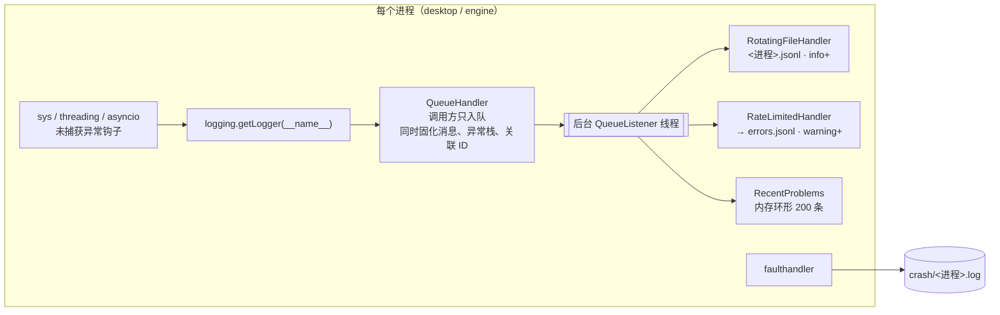

# INFRA-03 统一诊断日志

> 分支：`feature/logging`（基于 `feature/context-ledger`）
> 状态：已实现，全部测试通过（274 passed，基线 254 + 新增 20）
> 范围：只改“诊断日志”。会话事件、任务运行记录、Qwen wire trace、Context Ledger 的格式与位置都不变。

---

## 0. 结论先行

1. **做了什么**
   1. 新增 `boxagent/core/logs.py`，基于标准库 `logging`，不引入第三方依赖。每个进程入口调用一次 `configure_logging(log_dir, process=…)`，之后各模块照常 `logging.getLogger(__name__)`。
   2. 输出三类文件：
      1. `logs/<进程>.jsonl`：本进程 info 及以上；
      2. `logs/errors.jsonl`：所有进程的 warning 及以上，排障入口；
      3. `logs/crash/<进程>.log`：原生崩溃。
   3. 每条记录自动带 `session_id`、`interaction_id`、`task_id`，可以和会话轨迹、任务运行记录对上。
   4. 进程级、线程级、asyncio 级的未捕获异常都会落盘。
   5. **静默吞异常从 17 处降到 0 处**（不计第三方 vendored 代码），并加了一条架构测试，防止再新增。行为不变：原来降级的仍然降级，只是留下记录。
2. **为什么这样做**：参照 DSH Harness 的日志设计（见第 2 节），保留它的五个细节，并补上它没有的 JSON 格式与轮转。
3. **代价**：调用方只做入队，p50 4.7 µs，p99 11.8 µs；格式化和写盘在后台线程完成。
4. **真实运行验证**：重启后 `errors.jsonl` 立即出现两个进程的 `logging.ready` 标记。8 分钟后捕获到一条此前只写进 `context-worker.log` 纯文本的错误：`desktop observation stopped`，`RuntimeError: could not create image from window`，带完整调用栈。

---

## 1. 术语表

| 术语 | 含义 |
|---|---|
| 诊断日志 | 给人排障用的进程日志，回答“哪里坏了”。不是业务事实，可以轮转、删除 |
| 业务记录 | 会话事件 `events.jsonl`、Context Ledger、任务 `runs/`、Qwen wire trace。回答“发生了什么”，不轮转，不归本需求管 |
| 静默吞异常 | `except Exception:` 之后既不记录、不上抛，也不把错误交给调用方 |
| 关联 ID | `session_id` / `interaction_id` / `task_id`，用 `contextvars` 传递，随 asyncio 任务自动继承 |
| 就绪标记 | 每个进程启动时写入 `errors.jsonl` 的一条 `logging.ready`。没有标记的日志早于本模块，其中“没有报错”不能说明“没有出错” |

---

## 2. 动机

### 2.1 改造前的问题

| 问题 | 现象 |
|---|---|
| 没有统一入口 | 只有 4 处使用标准库 `logging`，并且没有配置 handler，记录全部丢失 |
| 静默吞异常 | 17 处 `except Exception` 后直接 `pass` 或 `return`。例如记忆召回超时直接返回空列表，用户只觉得“它没记住” |
| 没有关联 ID | 出错时无法知道属于哪个会话、哪次交互、哪个任务 |
| 未捕获异常无记录 | 线程里的异常只打印到 stderr；Engine 的 stderr 是追加写的纯文本 `engine.log`，没有时间戳 |
| 没有轮转 | `logs/events.jsonl` 已经 3.4 MB，持续增长 |
| 重复路径 | 早期版本写在数据根目录的 `engine.log`、`events.jsonl`、`memory-worker.log`、`context-worker.log` 和 `logs/` 下的同名文件并存 |

### 2.2 借鉴 DSH Harness

DSH 把诊断与业务分开：

1. 进程内每个子系统一个具名 logger，消息先进内存环形缓冲；
2. `dsh-desktop-log-bridge` 只把 warn/error 写到 stderr，桌面壳汇总进 `harness.log`；
3. 业务事实只写会话轨迹。

| DSH 细节 | 本实现 |
|---|---|
| 只把 warn/error 导出到共享日志 | `errors.jsonl` 只收 warning 及以上 |
| 限流：60 s 最多 100 条，下个窗口报告丢弃数 | `RateLimitedHandler`，同参数 |
| 每次启动写“从此开始记录” | `logging.ready` 标记，每个进程一条 |
| 内存环形缓冲 | `recent_problems()`：最近 200 条 warning+，供后续管理面板 |
| 统一行前缀，便于过滤 | 统一 JSON 字段：`process`、`logger`、`level` |
| （DSH 没有）结构化与轮转 | JSON Lines；按大小轮转；14 天清理 |

---

## 3. 怎么做的

### 3.1 总体结构

1. **只在入口配置**：`entrypoints/desktop.py` 和 `entrypoints/engine.py` 各调用一次。`core/logs.py` 只依赖 `core/errors.py` 的 `redact`，满足 `core` 层独立的架构约束。
2. **跨线程前先固化**：`_EnqueueHandler.prepare` 在调用线程里格式化消息、展开异常栈、读取 `contextvars`。后台线程不再访问可能已变化的对象。
3. **第三方库**：标准库根 logger 设为 warning，因此 `asyncio`、`websockets` 等库的警告也会被记录，它们的 info 不会刷屏。BoxAgent 自己的 logger 为 info。

### 3.2 记录格式

每行一个 JSON 对象，写盘前经过 `redact` 脱敏（`sk-…`、Bearer、`api_key` 等键）。

| 字段 | 示例 | 说明 |
|---|---|---|
| `ts` | `2026-10-10T10:05:14.426+00:00` | UTC，毫秒 |
| `level` | `error` | debug / info / warning / error / critical |
| `process` | `engine` | 进程角色 |
| `pid` / `thread` | `90076` / `MainThread` | |
| `logger` | `boxagent.infrastructure.perception.qwen_mlx` | 即模块名 |
| `msg` | `desktop observation stopped` | 英文短句，便于 grep |
| `session_id` 等 | `ses_…` | 仅在已绑定时出现 |
| `data` | `{"ms": 12}` | 可选结构化字段，`extra={"data": …}` |
| `exc_type` / `exc` | `RuntimeError` / 完整 traceback | 仅有异常时出现 |

### 3.3 关联 ID 的绑定点

| 位置 | 绑定 |
|---|---|
| `ConversationService.begin_interaction` | `session_id`、`interaction_id`、`task_id` |
| `TaskExecutor.run` | `task_id`、`session_id`、`interaction_id` |

`contextvars` 随 asyncio 任务复制：在某个任务内绑定的值只影响该任务和它之后创建的子任务，并发回合之间互不串号（有测试覆盖）。

### 3.4 未捕获异常

| 来源 | 机制 | 记录 |
|---|---|---|
| 主线程 | `sys.excepthook` | `critical uncaught exception`，写完后立即 flush，再交给原钩子 |
| 其他线程 | `threading.excepthook` | `critical uncaught exception in thread <名称>` |
| asyncio | `loop.set_exception_handler` | `error asyncio: <message>`；Engine 主循环、宿主的 Engine 客户端循环都已安装 |
| 原生崩溃 | `faulthandler` | `crash/<进程>.log`，所有线程的 Python 栈 |

### 3.5 文件维护

| 文件 | 策略 |
|---|---|
| `<进程>.jsonl` | 运行中按大小轮转，10 MB × 5 份 |
| `errors.jsonl` | 多个进程同时追加，运行中轮转会互相冲突，因此只在宿主启动时检查（10 MB × 3 份）；各进程用 `WatchedFileHandler`，轮转后自动重开 |
| 原始流文件 | `engine.log`、`events.jsonl`、`context-worker.log`、`memory/worker.log`、`memory/events.jsonl`、`context/*.jsonl`：宿主启动时超过 20 MB 就轮转，保留 3 份 |
| `runtime/qwen/events.jsonl` | **不轮转**：旧 Session 的上下文重建（REQ-01）需要读全量。留给后续统一轨迹存储（INFRA-01/02）处理 |
| 轮转备份与崩溃文件 | 超过 14 天删除；当前文件不删 |
| 数据根目录的旧日志 | 宿主启动时移到 `logs/legacy/`，不删除；只发生一次 |

### 3.6 失败隔离

1. `logging.raiseExceptions = False`：handler 出错不会抛进调用方。
2. 日志目录不可写时，改写 stderr，并打印一行原因。
3. 写盘在后台线程完成，磁盘慢不阻塞事件循环。
4. 重复调用 `configure_logging` 会先拆除旧配置（测试与热重载场景）。

### 3.7 静默吞异常的处理

原则：**行为不变，只补记录**。降级仍然降级，只是留下一条 warning。预期内的情况降为 info，或不带调用栈。

| 位置 | 原行为 | 现在 |
|---|---|---|
| `application/memory_context.py` 召回 | 返回 `[]` | 同左，并记 warning；超时不带栈 |
| `application/memory_profile.py` 画像提议 | 走本地兜底 | 同左，并记 warning |
| `application/memory_migration.py` 迁移写入 | 先核对再重试 | 同左，并记 warning |
| `domain/memory/service.py` 预热、L2 召回、健康检查 | 降级 | 同左，并记 warning |
| `domain/interaction/service.py` 主机回合注入、稳定画像、记忆注入 | 降级 | 同左，并记 warning |
| `infrastructure/context/qwen_ledger.py` 账本失败上报本身失败 | `pass` | 记 warning |
| `infrastructure/perception/qwen_mlx.py` 桌面观察停止 | 只写纯文本 worker 日志 | 另记 error，带栈 |
| `interfaces/engine/server.py` 请求失败 | 只把错误串返回客户端 | 另记 error，带栈和方法名 |
| `interfaces/macos/engine_bridge.py` 关闭、重启、接管旧 Engine | `pass` 或只发 UI 事件 | warning / error；接管失败属预期，记 info |
| `interfaces/macos/app.py` 历史刷新、系统通知、文字提交 | `pass` 或 `return False` | 同左，并记 warning |
| `interfaces/macos/inprocess_bridge.py` 关闭 | `pass` | 记 warning |

**豁免**：`infrastructure/memory/jev_mem/`（vendored 研究代码）、`infrastructure/runtimes/qwen/aoq.py`（原生 SDK 拆除，各方法可能不存在）、`core/logs.py` 自身。

**守护**：`tests/test_logging.py::NoSilentSwallowTests` 扫描全部源码。宽泛的 `except` 必须满足以下之一，否则测试失败：

1. 记录日志；
2. 重新抛出；
3. 交给 UI 或调用方（`publish`、`emit`、`set_exception`）；
4. 使用了异常对象，例如转成结果。

---

## 4. 排障表

先看 `logs/errors.jsonl`。下面的命令在 `.runtime/pet/logs/` 下执行。

| 症状 | 先查 | 命令 |
|---|---|---|
| 最近有什么错 | 最后 20 条 | `tail -20 errors.jsonl \| jq -c '{ts,process,logger,msg,exc_type}'` |
| 某个会话出过什么问题 | 按会话过滤 | `jq -c 'select(.session_id=="ses_…")' errors.jsonl engine.jsonl` |
| “它没记住” | 记忆降级 | `jq -c 'select(.logger\|test("memory"))' errors.jsonl` |
| 桌面观察不工作 | 感知模块 | `jq -c 'select(.logger\|test("perception"))' errors.jsonl` |
| Engine 反复重启 | 重启原因 | `jq -c 'select(.msg\|test("restart"))' desktop.jsonl` |
| 进程突然消失 | 未捕获异常、原生崩溃 | `jq -c 'select(.level=="critical")' errors.jsonl`；`cat crash/engine.log` |
| 日志里一条错都没有 | 先确认有就绪标记 | `jq -c 'select(.msg=="logging.ready")' errors.jsonl` |
| 怀疑有日志被限流 | 丢弃汇总 | `jq -c 'select(.data.dropped)' errors.jsonl` |

---

## 5. 测试

| 套件 | 用例数 | 覆盖点 |
|---|---:|---|
| 原有全量 | 254 | 全部通过，行为未变 |
| `tests/test_logging.py` | 20 | 分级落盘与就绪标记；异常栈与类型；脱敏；第三方库只收 warning；环形缓冲；关联 ID 绑定与恢复；并发 asyncio 任务互不串号；未知字段拒绝；`begin_interaction` 绑定；限流与丢弃汇总；目录不可写回退；坏记录不影响调用方；重复配置不重复写；线程异常；asyncio 异常；子进程崩溃落盘；轮转保留份数；按时间清理；旧日志迁移且只迁一次；静默吞异常守护 |
| **合计** | **274** | `UV_CACHE_DIR=/tmp/uvcache uv run --with pytest python -m pytest -q` |

开销：两万次 `logger.info`，入队 p50 4.7 µs，p99 11.8 µs；后台写完两万条用时 0.59 s。

---

## 6. 已知限制

1. **子进程的原始输出仍是纯文本**：Jev-Mem worker、MLX 感知 worker 的 stderr 仍写入各自的 `.log`，没有转成 JSON。这两个子进程运行在独立 venv 里，不导入 BoxAgent 包。
2. **`errors.jsonl` 只在宿主启动时轮转**：单次运行若产生超过 10 MB 的 warning 会超出上限。限流（每进程每分钟 100 条）把上界压到约 144 000 条/天。
3. **Qwen wire trace 未轮转**：理由见 3.5。
4. **UI 事件流 `events.jsonl` 仍由宿主同步写**：它是业务流水，本需求只给它加了启动时轮转。
5. **管理面板尚未展示**：`recent_problems()` 已就绪，留给 Electron 管理面板（UI-P1）。

---

## 7. 后续衔接

| 需求 | 依赖本次的部分 |
|---|---|
| INFRA-01/02 统一会话目录与轨迹 | 关联 ID；业务记录与诊断日志的边界 |
| UI-P1 管理面板 | `recent_problems()`；`errors.jsonl` 字段约定 |
| FIX-01 MLX 摘要重复 | 感知模块错误已可在 `errors.jsonl` 中定位 |
