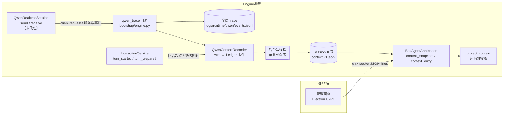
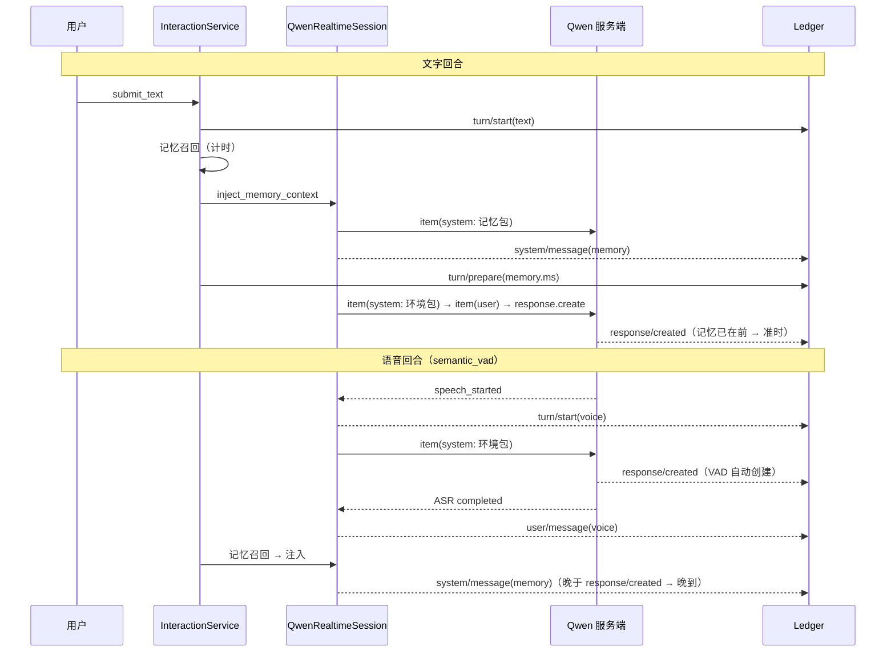

# REQ-01 前台上下文可观测（Context Ledger）

> 分支：`feature/context-ledger`（基于 `main` @ `daa0c32`）
> 状态：已实现，全部测试通过（254 passed，基线 233 + 新增 21）
> 界面：本 PR 只交付数据与 Engine 接口；查看界面由 Electron 管理面板（UI-P1）提供，见 3.6
> 范围：只做观测，不改 Qwen 行为。`boxagent/infrastructure/runtimes/qwen/` 目录下零行改动。

---

## 0. 结论先行

1. **做了什么**
   1. 每个 Session 目录下新增一份 **Context Ledger**（上下文账本）：`context.v1.jsonl`。它从 Qwen 实际收到的 wire 报文推导出“模型此刻看到了什么”，逐条写盘。
   2. Engine 新增两个接口，供管理面板读取：
      1. `context_snapshot`：当前上下文构成（分类、占比）、回合时间线（记忆召回耗时、是否晚到）、按发送顺序排列的条目预览；
      2. `context_entry`：按 `seq` 取一条的全文。
   3. 每回合记录宿主侧耗时，事件为 `turn/prepare`。目前只填了记忆召回；REQ-02 的 JEV 直接往同一事件里加字段即可。
2. **看到了什么**（把已有真实 trace 离线回放进 Ledger，覆盖 9 个 Session、113 个回合）
   1. **记忆包和环境包会一直累积**。最长的一代上下文里有 14 个回合，记忆包和环境包各 11 份，合计占估算 token 的 **42.6%**，超过固定开销（系统指令 + 角色设定 + 工具定义，35.9%）。
   2. **语音回合的记忆有 23.6% 晚到**（17/72）。晚到是指记忆包写入时 Qwen 已经开始生成回复，这份记忆不可能影响本轮回答。文字回合 0/19 晚到。
   3. **记忆召回本身很慢**：p50 ≈ 1.4 s，p90 ≈ 2.0 s。代码里的 `recall_timeout=0.35s` 只限制向量检索这一步，画像刷新等其余步骤不在限制内。
3. **代价**
   1. 主循环每条记录的开销 p50 = 0.22 ms。fsync 放在后台单线程里执行。
   2. 账本体积约为全局 trace 的 62%。
   3. 读取最大的一个账本（1159 条）并完成投影耗时 13 ms，快照约 23 KB。
4. **下一步的依据**：2.1 对应 REQ-03（删除过期注入项）；2.2 和 2.3 对应 REQ-02（JEV 与记忆并行，并把预算压到 300–400 ms）。

---

## 1. 术语表（首次出现即解释）

| 术语 | 精确定义 |
|---|---|
| Product Session | BoxAgent 自己的会话。目录为 `conversations/sessions/<ses_id>/`，与模型提供方的连接无关。 |
| wire 报文 | BoxAgent 经 WebSocket/AOQ 实际发给 Qwen 的非音频 JSON 消息（`client.request`），以及 Qwen 回传的事件。 |
| 上下文代（generation） | 一次 `session.update` 到下一次 `session.update` 之间，Qwen 服务端持有的同一份会话上下文。重连会开启新的一代，旧代内容对模型不再可见。 |
| Context Ledger | 按 Session 存储的 append-only JSONL。每行是一条“模型可见内容”或“回合生命周期”事实。 |
| 投影（projection） | 从 Ledger 纯函数计算出的视图：构成、条目、回合。可随时重算，不单独存储。 |
| 环境包 | 宿主每回合注入的 system 消息 `[BoxAgent可信运行环境]`，内容为时间、星期和时区。 |
| 记忆包 | 每回合注入的 system 消息 `<boxagent_memory_context>`，内容为 L2 召回结果。 |
| 晚到（late） | 记忆包写入时刻 $t_{\text{mem}}$ 晚于 Qwen 的 `response.created` 时刻 $t_{\text{resp}}$，即 $t_{\text{mem}} > t_{\text{resp}}$。 |
| 估算 token | 见 §3.4 的启发式公式，不是计费值。 |

---

## 2. 动机

1. **问题一：看不见**
   1. Qwen Realtime 的上下文保存在服务端，本地没有一份“当前上下文”的视图。
   2. 已有的全局 trace（`logs/runtime/qwen/events.jsonl`）混合了所有 Session，只能人工 grep。
   3. 回合前要加入 JEV 意图判断（REQ-02）、要删除过期注入项（REQ-03），都需要先有一把能做改动前后对比的尺子。
2. **问题二：已知的结构性风险，但没有量化**
   1. 环境包和记忆包每回合都追加，代码里没有任何 `conversation.item.delete`，所以只增不减。
   2. 语音回合由服务端 `semantic_vad` 自动创建回复，L2 记忆要等 ASR 完成后才注入，理论上会晚到。
   3. 这两条风险都缺少数据：占比多少？晚到多少？
3. **约束**
   1. 不改变 Qwen 行为：不改注入顺序、内容和时机。
   2. 账本写入失败不能影响对话；账本损坏只报错，不能让 Engine 崩溃。
   3. 数据只留在本地 Session 目录，随 Session 一起删除；只记文本，不记音频和图片。
   4. 事件命名对齐 DSH（路线 B）：`system/message`、`user/message`、`turn/start` 等。

---

## 3. 怎么做的

### 3.1 总体架构

1. **采集点选在 trace 回调上，而不是在业务代码里埋点**
   1. 所有非音频请求都经过 `QwenRealtimeSession.send` 并 trace 为 `client.request`；AOQ 子类同样如此。
   2. 因此账本内容与模型实际收到的内容逐字一致，也不需要改 Qwen 运行时代码。
2. **wire 上看不到的事实，由宿主补充**（`ContextObserver` 端口，domain 层定义）
   1. `turn_started(session_id, channel="text")`：文字回合的起点。必须在记忆召回之前写入，否则回合会被切错。
   2. `turn_prepared(session_id, memory={status, ms, chars})`：记忆召回的状态与耗时。REQ-02 会在这里追加 `jev={...}`。
3. **分层与依赖方向**（由 `tests/test_architecture.py` 守护）
   1. `domain/context/`：事件模型、token 估算、投影、端口，不依赖任何外层。
   2. `infrastructure/persistence/jsonl_context_ledger.py`：存储。
   3. `infrastructure/context/qwen_ledger.py`：wire 到事件的映射。刻意不放在 `runtimes/qwen/` 下，以免 import 时带入 websockets 和 pyaudio。
   4. `bootstrap/engine.py`：唯一的组装点。

### 3.2 账本格式

1. **路径**：`<data>/conversations/sessions/<ses_id>/context.v1.jsonl`
   1. 版本号写在文件名里。将来升到 v2 时写一个新文件，不原地改写（与 DSH 的 `session.v4.jsonl` 做法一致）。
   2. `session_id` 必须匹配 `^ses_[A-Za-z0-9]{1,64}$`，防止路径穿越。
2. **行格式**
   1. 第 1 行是头：`{"type":"ledger","version":1,"session_id":…,"created_at":…}`。
   2. 其后每行一个事件：`{"type", "seq", "time", "data"}`。
      1. `seq` 在 Session 内从 1 开始严格递增。
      2. `time` 是**观测时刻**，即主线程入队时的时间，不是写盘时间，所以后台写线程不会扭曲时延统计。
      3. 内容类事件的 `data` 固定包含 `category`、`role`、`content`、`chars` 和 `tokens`。
3. **耐久性**
   1. 每次追加后执行 `flush + fsync`。
   2. **尾部撕裂**（最后一行 JSON 不完整，或缺少换行符）：读取时忽略，下一次追加前重写修复。
   3. **中段损坏**：直接拒绝。`context_snapshot` 返回 `status=corrupt` 和行号，Engine 不崩溃。
   4. 字符串值经过 `redact`（`sk-…`、Bearer、base64 图片等）。注意 `tokens` 这类键名不能按键名脱敏，所以实现中只按值脱敏。
4. **事件类型**

| type | 来源 | category | 说明 |
|---|---|---|---|
| `context/rebuild` | `session.update` | — | 新一代上下文的起点，附 instructions 和 tools 的哈希 |
| `system/message` | `session.update` 拆分 | `instructions` / `persona` | 以 `PERSONA_BOUNDARY` 为界拆成两段 |
| `request/header` | `session.update` | `tools` | 9 个工具的 JSON schema |
| `system/message` | `conversation.item.create` | `profile` / `checkpoint` / `environment` / `memory` / `system_other` | 按前缀判定 |
| `user/message`、`assistant/message` | 重连恢复期间的 item | `history` | `session.update` 之后、第一个回合之前 |
| `user/message` | 文字 item / ASR completed | `user` | `channel=text|voice` |
| `user/message` | `[可信任务结果]` 合成 user item | `notification` | 后台任务完成通知 |
| `assistant/message` | `response.audio_transcript.done` | `assistant` | 只记转写文本 |
| `tool/call`、`tool/result` | function call / `function_call_output` | `tool_call` / `tool_result` | |
| `turn/start` | `speech_started` / 宿主 / 通知 | — | `channel=voice|text|notification` |
| `turn/prepare` | 宿主 | — | `memory={status, ms, chars}`；预留 `jev` |
| `response/requested`、`response/created` | `response.create` / 服务端 | — | 用于判定晚到 |

### 3.3 投影规则

1. **当前上下文** = 最后一个 `context/rebuild` 之后（含）的内容类事件。
   1. 依据：重连会新建服务端会话，旧代 item 已不可见。
   2. 更早的回合仍计入 `all_turn_count`，不会丢失。
2. **分类占比**：按估算 token 计算，用最大余数法取整，使各项之和严格等于 100.0%：
   $$p_i = \frac{\lfloor 1000\,T_i/T \rfloor + \delta_i}{10},\quad \sum_i \delta_i = 1000 - \sum_i \lfloor 1000\,T_i/T \rfloor,\ \delta_i\in\{0,1\}$$
   其中 $\delta_i=1$ 分配给小数部分最大的那几项。
3. **回合指标**（以 `turn/start` 时刻 $t_0$ 为原点）
   1. 回复创建：$\Delta_{\text{resp}} = t_{\text{response.created}} - t_0$
   2. 首段转写：$\Delta_{\text{asst}} = t_{\text{assistant/message}} - t_0$
   3. 晚到判定：$\text{late} \iff t_{\text{mem}} > t_{\text{resp}}$

### 3.4 token 估算

$$\hat T(s) = N_{\text{CJK}}(s) + \left\lceil \frac{N_{\text{other}}(s)}{4} \right\rceil$$

1. $N_{\text{CJK}}$：中日韩表意字、假名、谚文、全角标点（7 个 Unicode 区段）的字符数。
2. $N_{\text{other}}$：其余字符数。
3. 实现在 `boxagent/domain/context/estimate.py` 的单个函数里，以后换成真实 tokenizer 只改这一处。
4. UI 上明确标注为“估算”，不能当作计费依据。

### 3.5 回合起点的判定（时序）

### 3.6 读取接口与界面

1. **数据流**
   1. `context_snapshot(session_id)` 只返回 160 字以内的预览，避免快照过大。
   2. `context_entry(session_id, seq)` 按需取回一条的全文。
   3. 两个方法都走 Engine 的 unix socket。流行限从 asyncio 默认的 64 KiB 提到 16 MiB，有测试覆盖大于 64 KiB 的快照。
   4. `session_id` 为空时由 Engine 取 active session。
2. **旧 Session**：账本为空时，从全局 trace 只读重建该 Session（`source=trace_replay`），不写盘。
3. **状态**：`ready` / `empty`（附提示语）/ `unavailable` / `corrupt`。
4. **界面**：开发期间做过一个 AppKit + WKWebView 的临时查看窗口，用来验证接口。它不随本 PR 合入；正式界面由 Electron 管理面板（UI-P1）按 dsh-context 的结构实现。

---

## 4. 效果

> 数据来源：现有 `.runtime/pet/logs/runtime/qwen/events.jsonl`（1.16 MB）与 `logs/memory/events.jsonl`，由 `scripts/replay_context_ledger.py` 用生产代码 `QwenContextRecorder` 离线回放，写入临时目录。未调用任何 API，未改动真实 Session。

### 4.1 当前上下文构成（每个 Session 的最后一代）

| Session | 上下文代数 | 本代回合 | 条目 | 估算 token | 环境包份数 | 记忆包份数 | 环境+记忆占比 | 固定开销占比¹ |
|---|---:|---:|---:|---:|---:|---:|---:|---:|
| ses_c076…4763 | 1 | 14 | 61 | 6113 | 11 | 11 | **42.6%** | 35.9% |
| ses_ded3…41ba | 1 | 8 | 36 | 4455 | 7 | 7 | 37.2% | 49.2% |
| ses_727b…4b01 | 1 | 6 | 28 | 3963 | 6 | 6 | 35.9% | 55.4% |
| ses_f1c3…3f | 1 | 6 | 27 | 3880 | 5 | 5 | 30.5% | 56.5% |
| ses_4a7c…4dfc | 4 | 7 | 52 | 4488 | 5 | 5 | 26.4% | 48.9% |
| ses_9107…e1 | 4 | 2 | 18 | 2835 | 2 | 2 | 14.7% | 77.4% |
| ses_53e7…cfc | 2 | 2 | 13 | 2857 | 2 | 2 | 14.6% | 76.8% |
| ses_e014…3f | 2 | 1 | 8 | 2389 | 1 | 1 | 8.7% | 84.7% |
| ses_b889…b3 | 26 | 2 | 82 | 4387 | 1 | 1 | 5.4% | 50.0% |

¹ 固定开销 = 系统指令 + 角色设定 + 工具定义，每代各 1 份；ses_c076 为 2194 估算 token，9 个 Session 平均 2175（角色设定随 SOUL.md 版本略有不同）。

1. **解读**
   1. 回合数 $n$ 越多，环境包和记忆包的占比越高，且两者份数相等（$=n$ 的语音/文字回合数）。原因是二者每回合各追加一份，从不删除。
   2. 单份记忆包平均 552 字符、约 170 估算 token，是单份环境包（约 63 token）的 2.7 倍，是主要的累积来源。
   3. `ses_b889…` 发生过 26 次重连，每次重连都会清空累积，所以占比反而很低。这说明重连只是在掩盖累积问题。
2. **最长一代的分类明细**（ses_c076…4763，14 回合）

| 类别 | 份数 | 字符 | 估算 token | 占比 |
|---|---:|---:|---:|---:|
| 记忆包 | 11 | 6237 | 1914 | **31.3%** |
| 工具定义 | 1 | 2208 | 948 | 15.5% |
| 系统指令 | 1 | 931 | 715 | 11.7% |
| 环境包 | 11 | 1122 | 693 | 11.3% |
| 角色设定 | 1 | 563 | 531 | 8.7% |
| 任务通知 | 3 | 617 | 499 | 8.2% |
| 助手回复 | 15 | 420 | 393 | 6.4% |
| 用户画像 | 1 | 530 | 169 | 2.8% |
| 用户消息 | 11 | 139 | 133 | 2.2% |
| 工具结果 | 3 | 307 | 91 | 1.5% |
| 工具调用 | 3 | 108 | 27 | 0.4% |
| **合计** | 61 | 13182 | 6113 | 100.0% |

   1. 用户真正说的话只占 2.2%，宿主注入的记忆和环境占 42.6%。

### 4.2 回合时延与记忆晚到（全部 113 个回合）

| 通道 | 回合数 | 有记忆注入 | 晚到 | 晚到率 | 记忆召回 p50 / p90 / max | 回复创建 p50 / p90 |
|---|---:|---:|---:|---:|---|---|
| voice | 76 | 72 | 17 | **23.6%** | 1447 / 2011 / 2034 ms | 3041 / 4692 ms² |
| text | 19 | 19 | 0 | 0% | 1363 / 2006 / 2047 ms | 520 / 710 ms |
| notification | 18 | 1 | 0 | — | — | 574 / 776 ms |

² 语音回合以 `speech_started` 为原点，包含用户说话时长，因此不能与文字回合直接比较。

1. **解读**
   1. 语音回合约四分之一的记忆注入发生在 Qwen 已开始回答之后，这些 token 白占上下文，却影响不到本轮。
   2. 文字回合从未晚到，但这是靠阻塞换来的：`submit_text` 会等召回完成才发出 user item，所以召回耗时（p50 1.4 s）直接加在首响应延迟上。
   3. 召回 p50 约 1.4 s，是 `recall_timeout=0.35 s` 的 4 倍。超时只包住向量检索，`refresh_stable_profile` 等步骤不在预算内。REQ-02 需要把整段召回放进一个统一的 300–400 ms 预算。

### 4.3 开销

| 指标 | 数值 | 测法 |
|---|---|---|
| 主循环每条记录开销 | p50 0.22 ms / p95 0.32 ms / max 0.56 ms | 300 次 `observe(client.request)`，后台写入模式 |
| 单次落盘（fsync） | p50 2.55 ms / p95 7.80 ms / max 25.8 ms | 300 次 `append`，450 字记忆包；在后台线程执行，不阻塞对话 |
| 账本体积 | 9 个 Session 合计 0.72 MB，为全局 trace 1.16 MB 的 62% | 回放结果 |
| 最大账本读取 + 投影 | 1159 条事件 13.3 ms | `read + project_context` |
| 快照 JSON 大小 | 23.6 KB（最大 Session） | 只含 160 字预览 |

### 4.4 测试

| 套件 | 用例数 | 覆盖点 |
|---|---:|---|
| 原有全量 | 233 | 全部通过，行为未变 |
| `tests/test_context_ledger.py` | 20 | 估算公式；占比和为 100；表头与 seq；按值脱敏；尾部撕裂修复；中段损坏拒绝；路径穿越；重连分代；晚到判定；真实 `QwenRealtimeSession` 走 wire 后的条目顺序；环境包累积；语音回合；写失败不影响 `response.create`（同步与后台两种模式）；后台写保序并保留观测时刻；记忆耗时与失败状态上报；损坏账本返回 `corrupt`；预览与全文往返；旧 Session 从 trace 只读重建 |
| `tests/test_engine.py` | +1 | 跨进程 `context_snapshot`（>64 KiB）与 `context_entry` |
| `tests/test_architecture.py` | 更新 | 新文件存在；新具体类只在 bootstrap 中构造 |
| **合计** | **254** | `UV_CACHE_DIR=/tmp/uvcache uv run --with pytest python -m pytest -q` |

---

## 5. 变更清单

1. **新增**
   1. `boxagent/domain/context/`：`models.py`（事件与投影）、`estimate.py`（token 估算）、`contracts.py`（`ContextLedgerStore` / `ContextObserver` / `NullContextObserver`）。
   2. `boxagent/infrastructure/persistence/jsonl_context_ledger.py`：`JsonlContextLedgerStore`。
   3. `boxagent/infrastructure/context/qwen_ledger.py`：`QwenContextRecorder`。
   4. `boxagent/infrastructure/context/qwen_trace_history.py`：旧 Session 从全局 trace 只读重建。
   5. `scripts/replay_context_ledger.py`：离线回放与统计。
2. **修改**
   1. `domain/interaction/service.py`：文字回合起点；记忆召回计时与状态上报（失败仍静默降级）。
   2. `application/assistant.py`：`context_snapshot` 和 `context_entry`。
   3. `bootstrap/engine.py`：组装 Store 与 Recorder，挂到 qwen trace 回调上；失败日志写入 `logs/context/ledger.jsonl`。
   4. Engine 协议：两个新方法；流行限提到 16 MiB。
3. **未改动**：`boxagent/infrastructure/runtimes/qwen/` 全目录（`git diff` 为空）。

---

## 6. 已知限制

1. **token 是估算值**：未与 Qwen tokenizer 做过校准，误差大小未知；它适合比较同一 Session 内的相对占比和改动前后的变化，不适合作为绝对值。
2. **服务端截断不可见**：如果 Qwen 服务端自行截断或丢弃了旧 item，账本无法感知，展示的是“发出去的”，不是“服务端保留的”。
3. **语音的 `assistant/message` 以 `response.audio_transcript.done` 为准**：被打断（cancel）的回复可能没有 done 事件，因此不计入。
4. **历史数据**：账本只从本版本上线后开始写。旧 Session 读取时从全局 trace 重建，但 trace 里没有宿主的回合起点，文字回合的起点由记忆事件推断。
5. **Codex 任务上下文未纳入**：本需求只覆盖 Qwen 前台；Codex 的 thread 注入留到后续需求。

---

## 7. 后续需求的衔接

| 需求 | 本次提供的基线 | 验收时对比的指标 |
|---|---|---|
| REQ-02 JEV 回合前判断 | `turn/prepare` 事件和记忆耗时列 | 召回 p50 从 1.4 s 降到 ≤ 0.4 s；语音晚到率从 23.6% 下降 |
| REQ-03 删除过期注入项 | 环境包/记忆包份数与占比 | 14 回合时“环境+记忆”占比从 42.6% 降到 < 15%；份数恒为 1 |
| REQ-04 宿主控制 `response.create` | 晚到判定 | 语音晚到率 → 0（需要用户同意后做线上实验） |
